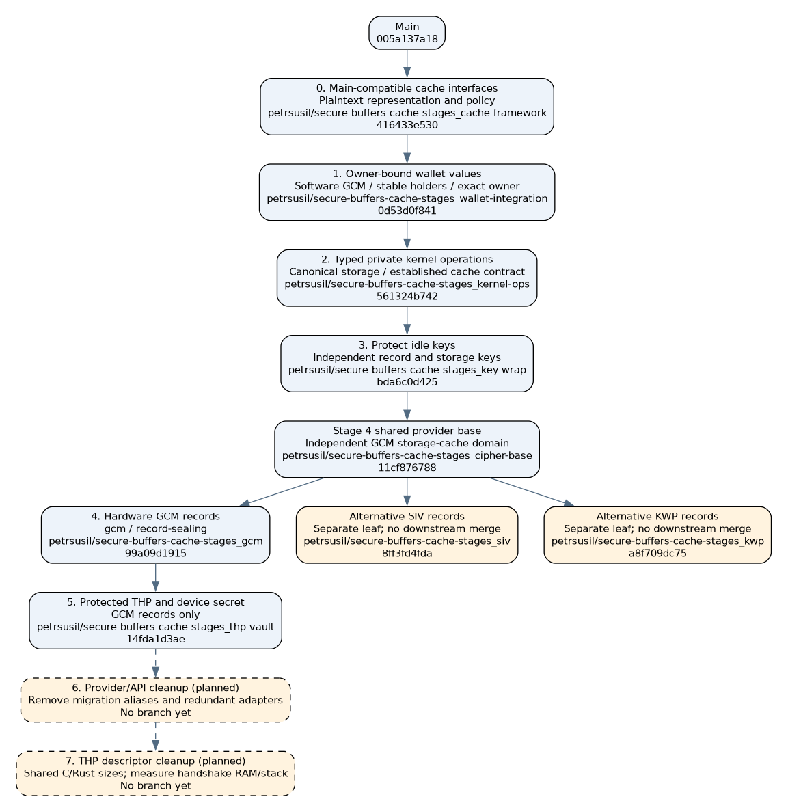
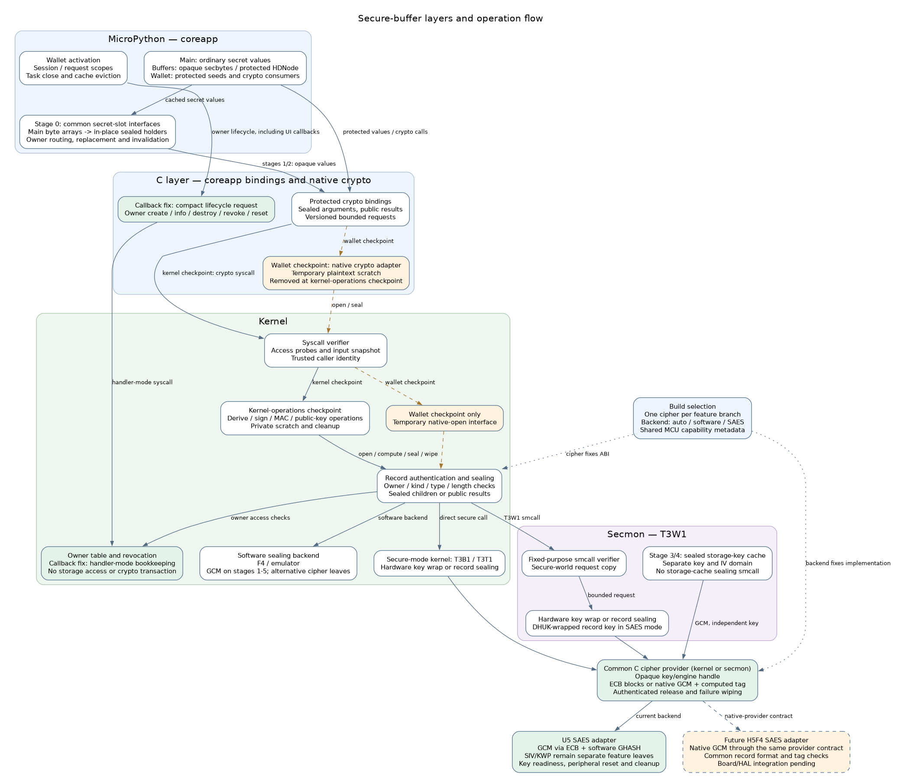

# Secure buffers architecture

## Feature dependencies from main

[Graphviz source](secure-buffers/features.dot). Arrows show current snapshot
ancestry. Dashed edges show proposed cleanup stages after the completed
migration; the completion conditions below define the required redesign.
The branches use `petrsusil/secure-buffers-cache-stages_`, based on main
`005a137a18`. SIV and KWP are alternative leaves; only GCM continues into
record-sealing and protocol stages.

## Layer flow

[Graphviz source](secure-buffers/layers.dot). Arrows show calls and processing
flow. Dashed paths are the temporary coreapp crypto adapter at the wallet
checkpoint; kernel operations replace that path. Secmon is the T3W1 path;
T3B1/T3T1 use their secure-mode kernel directly. The storage-cache backend evolves with stages 0–4.

## Proposed implementation stages

| Stage | Change | Cache handling | Implementation details | Key decisions for developers | Pitfalls | Security gained | Code lines + / − |
| --- | --- | --- | --- | --- | --- | --- | ---: |
| **0** `petrsusil/secure-buffers-cache-stages_cache-framework` | Introduce common interfaces for secret-value access, replacement and destruction, preserving main’s behavior. | Wrap only existing caches. Preserve capacities, derivation policy, reuse and invalidation events; keep the existing plaintext representation. | Add `get_secret` / `take_secret` / `delete_secret` and class-level slot declarations over existing containers; wrap C storage-key reads in snapshot/store/clear helpers. | Preserve main’s numeric keys, capacities and invalidation behavior. No new cache or per-entry wrapper; retain existing node/LRU/ZKP interfaces. | Accidental capacity, lifetime or allocation changes would invalidate the behavior-preserving baseline. | Structural preparation; no new confidentiality guarantee. | +114 / −30 |
| **1** `petrsusil/secure-buffers-cache-stages_wallet-integration` | Replace plaintext wallet values with owner-bound sealed records. | Switch existing seed, Cardano-secret and derived-node values to sealed representations. Migrate producers and consumers together, remove superseded plaintext allocations, and preserve reuse. | Seal records with software GCM; preallocate `secbytes` in secret slots. Transfer values to the exact target owner; revoke owners before clearing. | Centralize owner-local seed routing; keep holders stable and avoid duplicate plaintext capacity. Cardano signs from one bound node; no separate scalar/prefix snapshots. Coreapp remains trusted at this stage. | Cold or repeated seed PBKDF2 if reuse is lost; cross-owner retention; stale handles after revocation; callback reentrancy during replacement. | Idle wallet secrets become encrypted and owner-bound. | +3,584 / −664 |
| **2** `petrsusil/secure-buffers-cache-stages_kernel-ops` | Move private cryptographic operations and sensitive storage policy into the kernel. Enforce key types and signing-input consistency. | Move secret derivation and use behind kernel APIs. Keep cached values opaque to coreapp; enforce ownership, type and lifetime checks in trusted code. Preserve existing ZKP-context reuse. | Authenticate key type in record-header byte 6 and curve in node records; validate operations in the kernel. Snapshot bounded signing inputs; derive Icarus bits from stored words. | Keep operation numbers with an explicit versioned ABI. Enforce key/operation compatibility and trusted storage policy together; preserve boot-time ZKP reuse. | Cross-curve signing of one private scalar; mixed Cardano halves; mutable request inputs; inconsistent storage aliases or mnemonic copies. | Covered private operations stop exposing secrets to coreapp. | +1,420 / −1,063 |
| **3** `petrsusil/secure-buffers-cache-stages_key-wrap` | Wrap idle sealing keys and independently protect storage encryption keys. | Adapt the backend to wrapped idle keys. Protect the existing storage-key cache under an independent key, preserving its unlock/lock lifecycle and independence from vault resets. | Wrap the existing 48-byte DEK/SAK cache through the Stage-0 helpers; erase unwrap buffers and schedules. Protect idle record keys independently. | Separate record/cache keys and reset lifetimes. Use hardware key wrapping where available; retain an explicit kernel-RAM fallback on F4. | Plaintext remnants after unwrap; cache invalidation coupled to the wrong reset; implying hardware protection on software-only models. | Usable plaintext keys leave idle RAM on supported hardware. | +278 / −18 |
| **4** `petrsusil/secure-buffers-cache-stages_record-sealing` | Perform record encryption through hardware GCM with hardware-held keys. | Switch protected cache payloads to the SAES backend on supported hardware. Keep record and storage-cache keys and nonce domains separate; retain the software fallback elsewhere. | Route record encryption through an opaque key/provider interface. Use SAES with software authentication/counter processing where required; retain a software provider. | Only GCM enters subsequent stages. SIV and KWP are independent alternative branches from `cipher-base`. Keep the opaque provider contract ready for native GCM. | Nonce reuse after a counter restart without a new key; shared record/cache nonce domains; loaded peripheral keys surviving failure. | Active sealing keys and expanded schedules stay out of software RAM. | +867 / −16 |
| **5** `petrsusil/secure-buffers-cache-stages_thp-vault` | Move covered THP operations and device-secret access behind kernel APIs. | Adapt existing protocol values to the established protected-value interfaces and backend. Tie invalidation to their session, channel and reset lifetimes. | Move device-secret provisioning/reset and covered THP private operations into kernel APIs. Pass opaque descriptors across Rust/C bindings and check canonical storage aliases. | Keep channel/device lifetimes separate from wallet request/session lifetimes. Restrict device-secret writes when its consumers migrate; public metadata stays ordinary data. | Revoking an unrelated wallet owner with a channel; retaining device/channel secrets beyond their lifetime; alternate storage aliases bypassing policy. | Protocol secrets gain the kernel boundary and lifetime controls. | +286 / −50 |
| **6 (planned)** `petrsusil/secure-buffers-cache-stages_cleanup-api` | Simplify the completed vault/provider interfaces and remove migration compatibility plumbing. | Preserve existing seed, Cardano and storage-key reuse, capacities, owners and invalidation. | Migrate callers to provider-neutral request types; remove `VAULT_SAES_*` compatibility aliases and redundant forwarding headers. Retire legacy build-selection aliases after their callers migrate. | Keep the opaque provider contract, native-GCM hook, explicit unsupported-backend errors, software fallback and numerical wire ABI. Limit removals to secure-buffer migration plumbing; preserve APIs and valid plaintext-key operations used on main. | Deleting a still-used API; changing a request layout or operation number during a source-only cleanup; accidentally selecting another cipher. | Same confidentiality and revocation guarantees; fewer interfaces and paths to audit. | — |
| **7 (planned)** `petrsusil/secure-buffers-cache-stages_cleanup-thp` | Compact THP key descriptors and reduce duplicated handshake state. | Preserve all existing cache policies and lifetimes; introduce no additional cache. | Replace the fixed 256-byte FFI handle with a size derived from the protected key record. Share the C/Rust size definition and expand compact descriptors into bounded, zero-initialized RPC requests. | Keep the descriptor authenticated and owner-bound. Choose compact inline storage or owned indirection after measuring handshake RAM/stack. Separate opaque static identities from native ephemeral keys where useful. | C/Rust size disagreement; truncating authenticated data; invalid clone/drop lifetimes; making every ephemeral key reserve the largest descriptor variant. | Same protected-key lifetime guarantees with less retained descriptor state. | — |

Stages 0–5 form the required cumulative implementation chain. The shared
`cipher-base` commit is part of Stage 4; its GCM feature continues to Stage 5.
SIV and KWP remain alternative leaves from that same base. Proposed cleanup
stages 6–7 follow Stage 5 and preserve all six earlier checkpoints.

Hardware key-protection guarantees apply on supported hardware; the software
fallback retains the previous stage’s applicable guarantees.

Cache protection evolves within each security stage; it has no separate rollout
stage. Each endpoint must remain functional and include the adaptations its
changes require. Hardware validation remains a separate checkpoint; native and
emulator results do not substitute for the full hardware matrix.

Counts cover C/Rust/Python source, excluding comments, blank lines, generated
files and tests. Stage 0 is measured from `005a137a18`; subsequent stages are
measured from their predecessor. Stages 6–7 are proposed; their branches and
implementation counts do not exist yet.

| Optional feature | Placement | Benefit / boundary | Branch suffix |
| --- | --- | --- | --- |
| Credential-encryption key reuse | Optional follow-up after stage 2; excluded from the current stage sequence | Saves SLIP21 derivations and vault calls with the seed already warm; operation-scoped, not the PBKDF2 fix. | Not carried in this sequence |
| Transaction cipher-context reuse | Optional follow-up after stage 5; excluded from the current stage sequence | Avoids repeated unwrap/expansion within a transaction; always erased on transaction exit. Software KWP replaces its schedule when direction changes. | Not carried in this sequence |

### Later cleanup checkpoints

Compatibility with main is a completion condition for each cleanup: existing
device identities and credentials, THP wire messages, pairing/reconnect/reset
behavior, storage formats and upgrade/downgrade behavior remain compatible.
A cleanup that requires a host update, re-pairing, key regeneration or storage
migration is outside these stages. Wallet PIN/passphrase prompts and cache
reuse remain unchanged.

| Cleanup stage | Completion checkpoint | Benefit to measure |
| --- | --- | --- |
| 6. Interface cleanup | Every remaining caller uses the canonical provider API; removed aliases have no users. Record formats, operation numbers, owner checks, cache reuse and failure cleanup are unchanged. | Source/API reduction and linked flash; naming-only changes may save no runtime memory. |
| 7. THP descriptor cleanup | Identity, credentials, wire messages and pairing/reconnect/reset behavior match main and Stage 5; cancellation and clone/drop lifetimes are preserved. C and Rust agree on descriptor size; malformed/truncated descriptors fail before use. | `DhKey`, handshake/channel sizes, peak handshake stack and allocation counts before/after. |

THP uses an internal key descriptor across its C/Rust boundary. It contains an
owner ID and an encrypted key record; the vault uses it to perform X25519
without exporting the private scalar. Its bytes remain inside the firmware.
THP public keys, messages and credentials retain main’s format and derivation.

The current THP FFI handle reserves 256 bytes. A GCM record for its 32-byte
private key occupies 64 bytes; adding its 4-byte owner gives a 68-byte compact
descriptor before surrounding alignment. This is a sizing target, not a
measured whole-handshake saving: enum layout, public-key storage and descriptor
copies determine the actual result.

Erasure, authentication and revocation remain complete in stages 1–5. These
later cleanups simplify an already functional implementation; they do not
supply guarantees deferred from an earlier stage. SIV and KWP remain separate
leaves, and only GCM enters the cleanup stages.

### Shared prerequisites and required code reorganization

- **Transport ownership before erasure.** A queued USB packet belongs to the
  driver until completion, so caller-buffer reuse or wiping cannot alter it.
  The independent USB correction must precede any frame/scratch erasure that
  invalidates a borrowed TX buffer. Keeping that correction at the historical
  branch tip is not a valid completion ordering for stages relying on erasure.
- **Trust boundary and signing values.** Stage 1 preserves main’s trusted
  coreapp model while sealing idle values. Cardano’s first protected signing
  API accepts one authenticated node, never independently selected halves.
  The kernel boundary and authenticated per-operation key types arrive in
  Stage 2. Neither backend exports Cardano scalar/prefix snapshots.
- **Cache continuity through migration.** Stage 0 keeps main’s plaintext
  representation and reuse policy. Stage 1 switches the producer, consumer and
  slot representation together. Stage 2 moves the established contract behind
  kernel APIs. No completed stage removes seed reuse or carries a second
  unused plaintext payload beside its sealed replacement. New performance
  caches remain optional sibling features.
- **Storage authority moves with its consumers.** Kernel-derived roots and
  protected-write/backup rules arrive together in stage 2. Device-secret
  restrictions arrive with the protocol consumer migration in stage 5, so no
  checkpoint disables a storage path still needed by its current consumers.
- **Hardware invariants before first hardware use.** Key readiness, request
  bounds/ABI checks, key rotation and failure cleanup also cover the shared
  hardware storage-cache path; they cannot wait for a later record cipher.

### Hardware validation checkpoints

| Stage | Implemented checkpoint | Remaining verification |
| --- | --- | --- |
| 1 | Owner-bound in-place wallet slots, software GCM and bound-node Cardano signing. | T3T1 universal build, all 148 emulator unit files and native bound-node regressions pass. Hardware run [41024223378](https://github.com/trezor/trezor-firmware/actions/runs/41024223378) tests `0d53d0f841`; both T2T1 jobs failed hub control before tests. |
| 2 | Typed kernel operations, canonical mnemonic source, storage policy and immutable signing inputs; bound-node Cardano contract preserved. | Full hardware matrix on the new revision. Historical run 40843346893 does not validate this implementation. |
| 3 | Independent wrapped record/cache keys, transient erasure and preserved unlock/reset lifetimes. | Full hardware matrix on the new revision. |
| 4 | Hardware GCM records and independent storage-key domain; SIV/KWP remain unmerged alternatives. | Full hardware matrix on the new revision. Historical run 40883629899 does not validate this implementation. |
| 5 | Protected protocol/device-secret operations, canonical alias guards and kernel-only provisioning. | Full hardware matrix on the new revision. |

Hardware tests advance strictly in the requested order **1 → 3 → 5 → 2 → 4**.
The next workflow is dispatched only after the previous workflow finishes with
conclusion `success`. A failure or cancellation stops advancement until the
current stage is repaired and revalidated.

A focused deferred-controller check of the actual HID/WebUSB write functions
fails caller-buffer reuse on baseline `6f1ab9a08e` and passes with the USB
packet-ownership correction. That establishes the lifetime defect, not the
cause of every hardware timeout. The 16-byte heap assertion likewise remains
unexplained; neither failure is waived by the completion conditions.

### Cleanup within each stage

Cleanup is part of each stage's completion boundary. It runs after each
operation and at the relevant request, session or key-lifetime boundary,
including failure paths; it is not deferred to stage 5.

| Stage | Cleanup included | Security gained from cleanup |
| --- | --- | --- |
| 1. Sealed wallet values | Erase native plaintext copies and crypto scratch after use; revoke owners when requests/sessions end. | A later coreapp memory read finds fewer residues, and captured records lose access when their owner ends. |
| 2. Kernel private crypto | Erase kernel private scratch, transient crypto state and secret-bearing input snapshots on every exit. | Secrets relocated out of coreapp do not persist as leftovers in reusable kernel memory. |
| 3. Hardware-protected sealing keys | Erase plaintext key-generation, unwrap and storage-key working buffers; discard obsolete wrapped/cache state when its lifetime ends. | Hardware wrapping is not undermined by a leftover plaintext copy of the same key in RAM. |
| 4. Hardware record encryption | Reset peripheral key/data state and erase software authentication intermediates and temporary plaintext. | Completed operations leave neither loaded peripheral keys nor avoidable secret-derived software residues. |
| 5. Protected protocol secrets | Erase protocol-specific private intermediates and revoke their records when the operation or session ends. | Extends bounded exposure and explicit revocation to the newly protected protocol values. |

Erasure reduces how long transient plaintext remains readable; moving an
operation behind a stronger boundary reduces who can read it while active.
Deleting a Python reference alone does not establish erasure. Owner revocation
invalidates every sealed copy for that owner without finding and overwriting
each copy; erasing one record object does not revoke other copies.

| Branch/checkpoint | Cleanup included |
| --- | --- |
| `cleanup` | Shared SHA-2 schedule erasure, Ed25519 intermediate wiping, bounded stack scrubber and returned storage/secure-call frame cleanup; directly based on main. |
| `buffers` / `native-transport` | Inherit shared cleanup; add vault scratch/frame erasure, owner teardown and callback-safe lifecycle. |
| `wallet-integration` | Inherits earlier cleanup; erases coreapp adapter scratch and message snapshots. |
| `kernel-ops` | Inherits earlier cleanup; erases kernel vault scratch, message snapshots and sealing contexts without dropping owner-info metadata. |
| `key-wrap` / `cipher-base` | Inherit earlier cleanup; erase wrapping, storage-cache and hardware-sealing intermediates and clear failed output. |
| `gcm` / `siv` / `kwp` | Inherits earlier cleanup; resets peripheral state, erases shared cipher scratch and handles final-reset failure. |
| `thp-vault` | Inherit shared and feature-local cleanup; add protocol-specific erasure and lifetime reset. |

These checks cover the explicit native buffers and returned frames exercised
by the regression suite; they are not a general proof of erasure under
arbitrary faults or reads during an active operation.

A completed stage preserves the existing wallet and protocol behavior,
including supported coins, PIN/passphrase, backup/recovery, preauthorization,
FIDO and THP. Native and emulator checks, hardware bootstrap and device tests
validate that boundary. An unresolved regression keeps a stage incomplete;
the branch checkpoints below are development snapshots.

## Threat model

| Attacker capability | Protection | Boundary or limitation |
| --- | --- | --- |
| Buffer over-read exposing coreapp memory | Sealed records hide idle wallet secrets; kernel crypto keeps covered private operations outside coreapp. | The coreapp-crypto stage still exposes temporary native plaintext during operations. |
| Passive physical dump of idle RAM | Encryption hides record contents; hardware wrapping keeps usable sealing keys out of idle RAM. | A software-only wrapping key captured with the records defeats that protection. ECB also reveals equal plaintext blocks. |
| Buffer overwrite or forged syscall input | KWP/SIV/GCM authenticate ciphertext and bind owner, kind and length; verifiers snapshot bounded inputs. | ECB does not authenticate records or their metadata. |
| Physical modification of record memory | Authentication rejects altered records before their plaintext is released to callers. | Verification relies on the trusted execution path remaining intact. |
| Replay of an unchanged record | Owner revocation and key replacement invalidate records at lifetime boundaries. | Authentication alone does not prevent replay while the owner and key remain valid. |
| Read of private scratch during an operation | Kernel placement limits coreapp access; explicit erasure reduces residual plaintext. | A physical read of active private scratch can still expose secrets. |
| Compromised coreapp using valid handles | The kernel enforces caller identity, live owners and operation checks. | Cooperative request scopes do not stop coreapp from requesting otherwise permitted operations with its own handles. |
| Kernel/secmon code execution or fault injection bypassing checks | Repeated checks and wipe verification harden selected failure paths. | Record encryption does not provide general protection against compromise of the trusted execution layer or arbitrary faults. |

## Authenticated encryption

| Attack on a Trezor vault record | Required access | Attacker gain without authentication | SIV/GCM mitigation |
| --- | --- | --- | --- |
| Reuse a revoked signing key: save its sealed record, then change its owner ID to a new live request after the original owner is destroyed. | Capture and rewrite a coreapp record, then submit it through a permitted vault operation while storage is unlocked and the sealing key is unchanged. | Regain use of the revoked key, including signing capability, without learning its plaintext. | The owner is authenticated with the ciphertext; relabeling invalidates the tag. |
| Substitute a wallet seed: take a sealed seed whose plaintext the attacker knows from another context in the same boot and relabel it for the victim's owner. | Obtain that seed record under the same vault key and replace the victim's record before derivation. | Cause derivation of receiving addresses whose private keys the attacker knows, exposing later deposits to theft. | Authentication binds the seed to its owner and rejects that cross-context substitution. |

The owner-relabeling primitive is reproduced in the native byte vault: after
revocation, the unchanged record is rejected in all three modes; rewriting
only its owner revives the original secret with ECB and is rejected with SIV
and GCM. The signing and seed-substitution outcomes depend on the operation
and application path available to the attacker; they are not demonstrated
end-to-end device exploits. A rekey invalidates the captured ciphertext.

For strictly read-only memory disclosure, authentication adds no protection
against reading plaintext beyond the encryption itself. Its value here is
rejecting forged records at the coreapp-to-kernel boundary. A random boot key
does not prevent the attacks above while that same key remains active.

SIV/GCM combine confidentiality with record integrity; neither proves that a
request is authorized, prevents valid-record replay, or protects plaintext
already exposed in active scratch. Arbitrary coreapp code execution can also
alter displayed addresses or request permitted operations through paths that
record authentication does not cover. The unauthenticated ECB option retains
the record-forgery paths above. [NIST SP 800-38D](https://csrc.nist.gov/pubs/sp/800/38/d/final)
defines the authenticated-encryption and associated-data construction used
by GCM.

## Architecture checkpoints

| Checkpoint | Revision | Implemented boundary |
| --- | --- | --- |
| `petrsusil/secure-buffers-cache-stages_cache-framework` | `416433e530` | Existing main caches behind common interfaces; plaintext behavior preserved. |
| `petrsusil/secure-buffers-cache-stages_wallet-integration` | `0d53d0f841` | Owner-bound software-GCM records, preserved seed reuse and bound-node Cardano signing; trusted coreapp crypto. |
| `petrsusil/secure-buffers-cache-stages_kernel-ops` | `561324b742` | Typed private kernel operations, canonical mnemonic and storage policy; established cache interface retained. |
| `petrsusil/secure-buffers-cache-stages_key-wrap` | `bda6c0d425` | Hardware-protected idle record keys and independent wrapped storage-key backend. |
| `petrsusil/secure-buffers-cache-stages_cipher-base` | `11cf876788` | Provider contract, bounded secure-world ABI and independently keyed hardware-GCM storage cache; software record encryption. |
| `petrsusil/secure-buffers-cache-stages_gcm` | `99a09d1915` | Hardware GCM records; the record-sealing branch points to the same commit. |
| `petrsusil/secure-buffers-cache-stages_siv` | `8ff3fd4fda` | Alternative SIV records with independent MAC/CTR keys; never merged into later stages. |
| `petrsusil/secure-buffers-cache-stages_kwp` | `a8f709dc75` | Alternative RFC 5649 KWP records; never merged into later stages. |
| `petrsusil/secure-buffers-cache-stages_thp-vault` | `14fda1d3ae` | Protected THP operations and kernel-only device-secret provisioning on the GCM path. |

GCM, SIV and KWP have the same `cipher-base` parent. Record-cipher code, build
selection and independent vectors belong to the selected feature. Later stages
contain GCM record support only. The independent USB correction and optional
new performance caches are outside this security-stage sequence.

Measurement revisions below refer to the original measured firmware; they are
historical comparisons, not validation of these rewritten checkpoints.
Record formats and operation sets are fixed by each checkpoint’s `vault.h`.

## Components and boundaries

- `secbytes` contains an opaque sealed record. It has no buffer protocol,
  indexing, hexadecimal conversion or plaintext getter. Protected `HDNode`
  objects contain sealed node state; private-key snapshots are independent
  sealed values.
- Coreapp holds records and associates tasks with request and session owners.
  The kernel holds a bounded owner table, sealing state and temporary native
  scratch. There is no kernel allocation per secret.
- In the wallet-integration checkpoint, native crypto still executes in
  coreapp and opens records through a temporary native interface. In the
  kernel-operations checkpoint, covered private operations execute in the
  kernel and return sealed values or public results. Explicit protocol exports
  are separate operations with their own restrictions.
- On T3B1 and T3T1, the secure-mode kernel accesses SAES directly. On T3W1,
  fixed-purpose smcalls copy sealing requests into secmon, where SAES and the
  storage key cache reside. In the combined prototype, record sealing and
  storage-cache sealing use separate keys; the storage-cache key has no
  smcall interface.
- Software sealing remains available on F4 and the emulator. Bindings,
  verifier and vault share the cipher layout and wire ABI. The backend is
  selected independently and does not change the format for that cipher.

## Records and lifetime

A record contains an owner ID, kind, plaintext length, reserved bytes,
cipher-specific nonce, ciphertext and authentication tag. Authenticated
modes bind the owner, kind and length to the ciphertext. Secret bytes and
private nodes have distinct kinds. The wire structures and limits live in
`core/embed/sec/vault/inc/sec/vault.h`; cipher-dependent sizing lives in
`core/embed/sec/vault/inc/sec/vault_mode.h`. Record encoding and owner state
live in `core/embed/sec/vault/store.h`, and sealing in `seal.c`.

GCM uses a per-key unique nonce and a 16-byte tag. Stages 1–3 use software
GCM. Stage 4 uses SAES on supported MCUs and software elsewhere. SAES ECB is
an internal AES primitive for authenticated GCM; there is no ECB record mode.

| Record feature branch | Software selection | SAES selection | Record keys | Authentication |
| --- | --- | --- | --- | --- |
| `gcm` | `gcm` | `saes-gcm` | One AES-256 key | Owner, kind, type, length and payload; 128-bit tag |
| `siv` | `siv` | `saes-siv` | Independent AES-256 MAC and CTR keys | Owner, kind, type, length and payload; synthetic IV/tag |
| `kwp` | `kwp` | `saes-kwp` | One AES-256 key | RFC 5649 wrapping of metadata and payload; 64-bit integrity |

Each feature accepts only its own record cipher. Selecting another cipher
requires its alternative branch. Software and SAES use the same format within
a feature. Storage-key protection remains independently keyed GCM on SAES,
including on the SIV and KWP alternatives; the software storage-key backend
introduced at stage 3 uses RFC 3394 key wrapping.

### Cipher and backend checkpoints

| Selection | Values | Invariant |
| --- | --- | --- |
| `TREZOR_VAULT_CIPHER` | The selected branch’s cipher only | GCM on the main stage sequence; SIV/KWP only on their alternative branches. |
| `TREZOR_VAULT_BACKEND` | `auto`, `software`, `saes` | Stage 4 follows MCU capabilities; explicit `saes` fails if unsupported. |
| `TREZOR_VAULT_MODE` | The selected cipher or its `saes-*` form | Cannot be combined with the independent cipher/backend settings. Stages 1–3 accept software `gcm` only. |

The opaque provider API, owners, key types and storage/cache lifetimes are
shared across alternatives. Cipher IDs, header/envelope sizes and padding
live in `vault_mode.h`; node and flexible-holder sizes use that layout.
Backend changes preserve the format; changing the cipher changes its ABI.

The models crate exports the MCU identity to every C-building crate. The
build policy uses that capability instead of inferring SAES from Cortex-M
architecture. F4 selects software; current U5 parts select SAES with an
ECB-based GCM implementation. H5F4 is described as SAES with native GCM.
Describing that capability does not provide its board/HAL implementation.

| Boundary | Code / contract | Checkpoint |
| --- | --- | --- |
| Build policy | `xbuild/src/vault.rs`, shared MCU metadata | One algorithm/backend decision across coreapp, kernel and secmon; invalid combinations fail before compilation. |
| Record ABI | `sec/vault_cipher.h`, `vault_mode.h`, `vault.h` | Bounded request, fixed GCM IV/tag sizes, mode-specific envelope; no key or provider pointer in the wire message. |
| Provider | `vault_cipher_provider_t` | Opaque backend context, AES ECB callback and optional native-GCM callback; no RAM-held key export is required. |
| GCM | `vault/gcm.h` | Native GCM when supplied; otherwise ECB/CTR/GHASH. Failed native operations never retry through another backend. |
| KWP | `vault/record_backend.h`, `vault/kwp.h` | Standard wrapping sequence over the provider's encrypt/decrypt blocks; hardware errors remain distinct from failed integrity. |
| MCU adapter | `vault_kek/stm32u5/vault_kek.c` | Key generation/retention, loading, peripheral readiness and final reset stay in the MCU driver. |

Native GCM receives the IV, AAD and ciphertext through trusted buffers and
returns output and a computed 16-byte tag. The common code checks that tag
twice before copying plaintext to the response, and erases temporary output
and tags on all exits. Invalid lengths, metadata/tag changes and hardware
failures release no plaintext. The storage cache passes its independent key
context through the same GCM contract, including on the separate KWP record feature.

The H5F4 port checkpoint is a chip-specific provider for ECB and native GCM,
with hardware-key lifecycle and cleanup, selected by the existing capability
policy. Its key-container representation is MCU-private; record/cache key
domains, fresh keys across nonce-counter restarts and RESET invalidation
must remain independent of that representation. Board/Cargo/HAL integration and hardware validation remain future
work. A native-capable platform rejects a missing native adapter; U5 rejects
a native-GCM capability rather than binding it to its ECB-only driver. Native-provider stand-ins verify the contract, cross-provider
ciphertext interoperability, failure cleanup and absence of fallback; they
do not validate H5 silicon.

Provider selection introduces no per-secret allocation or new persistent
key state. Record/object layouts stay unchanged. Historical timing and stack
measurements below remain pinned to their stated source revision; they are
not measurements of a future H5F4 provider or this later provider refactor.

### SIV and GCM footprint

T3T1 components at `06c5d87654`, cross-compiled with Arm GNU Toolchain
13.3.Rel1 (`-Os`, `PRODUCTION=1`, otherwise identical flags). These are not
whole-firmware or peak-stack measurements.

| Component | SIV | GCM |
| --- | ---: | ---: |
| SAES driver code and constants | 3,932 bytes | 2,396 bytes |
| SAES driver static RAM | 109 bytes | 73 bytes |
| Record header and tag | 24 bytes | 32 bytes |
| Sealed 32-byte key, excluding object and allocator overhead | 56 bytes | 64 bytes |
| Software-only expanded-key context | 488 bytes | 340 bytes |

SIV adds 1,536 bytes of driver code and constants and 36 bytes of driver
static RAM, but saves 8 bytes per sealed record before allocator rounding.
The software-only context sizes do not apply to SAES-held keys. Other
mode-dependent buffers and stack usage are outside these component totals.

The SAES storage-key cache already uses GCM with its own key and IV domain,
independently of the record cipher. Both driver totals therefore include
GCM for that cache; selecting SIV records adds the SIV path alongside it.

### Secure-buffer reduction checkpoints

| Change | Flash reduction | RAM reduction | Boundary |
| --- | --- | --- | --- |
| Select GCM instead of SIV records on SAES | 1,536 bytes in the measured production driver | 36 bytes of driver state; records grow by 8 bytes before allocator rounding | Already included in the GCM-default change. |
| Remove experimental ECB/SIV record paths and their hardware self-tests | Deletion experiment: 2,458 bytes in the test driver, zero additional bytes in the production GCM driver | No additional measured driver static saving | Removed from the GCM stage sequence; retained on the independent SIV feature where required. SAES ECB remains the AES primitive used by GCM. |
| Replace the software storage-key cache's SIV with GCM | Intermediate implementation: 831 bytes less code/constants in the T2B1 cache object | Static state 178 to 161 bytes; expanded context 488 to 340 bytes; unwrap buffer 80 to 40 bytes | Independent cache key and nonce domain; record SIV support remains available. |
| Replace the software storage-key cache's GCM with RFC 3394 key wrap | Implemented: another 157 bytes less code/constants in the T2B1 cache object | Cache state 128 to 97 bytes; total cache-object static state 161 to 130 bytes; AES context 244 instead of GCM's 340 bytes | No nonce state; 64-bit wrapping integrity replaces GCM's 128-bit tag. Record sealing and the SAES cache are unchanged. |
| Drop the unused plaintext sessionless seed field | Not measured | 64 payload bytes | Implemented; the sealed no-passphrase seed cache remains. |
| Omit no-passphrase holders in Bitcoin-only builds | Not measured | Estimated 1,232 bytes for Codec or 2,352 bytes for THP | No production Bitcoin-only consumer uses this cache; verify restart and allocation behavior. |
| Omit unused wallet/Cardano holders from the sessionless cache | Not measured | Estimated 416 bytes in universal builds | Keep its no-passphrase seed holder and owner. |
| Replace the extended-signing request's second blob with a nonce field after Cardano signs from its node | Not measured | Request 404 to 224 bytes on the 32-bit target: 180 bytes per stack copy | Requires the Cardano API migration and an ABI bump; this is stack headroom, not automatically smaller reserved stacks. |

The software storage cache wraps the 48-byte storage keys with RFC 3394
under a fresh AES-256 cache key, itself kept as a 40-byte wrapped key between
calls. The wrapped storage keys occupy 56 bytes. No nonce or counter is
needed. Reads release plaintext only after the 64-bit integrity value is
checked twice. Wrapping failure clears the cache; wipe also clears the
software wrapping key where present. Vault/VM resets leave the storage cache
independent. The SAES storage cache continues to use GCM.

Cache-object measurements use the T2B1 `-Os` test-build compiler flags
from `kernel.cc.json`. Compared with the preceding GCM implementation,
the key-wrap set frame is 424 instead of 416 bytes and the get frame is
384 instead of 448 bytes; the separate GCM context-setup frame disappears.
These are individual compiler-reported frames, not peak call chains or
smaller reserved stacks. Wrapping the cache key takes 24 AES operations;
wrapping the 48-byte storage keys takes another 36. Software cache-object
code/constants total 1,280 bytes, compared with GCM's 1,437 bytes.

Holder estimates assume 16-byte MicroPython GC blocks: a GCM 64-byte holder
uses 112 bytes and a 96-byte holder 144 bytes, including object storage and
rounding. They exclude changes to Python instance maps. Codec preallocates ten
protocol caches; THP twenty; both also have the sessionless cache. Against SIV,
GCM adds 16 allocated bytes to each of these holders. The current layout uses four holders per universal session and one in the
sessionless cache; Bitcoin-only sessions use one wallet-seed holder. These
ARM holder estimates exclude instance maps and vectors; the measured host
container reductions are recorded in [cache checkpoints](secure-buffers/caches.md).

[Cache checkpoints and measurements](secure-buffers/caches.md) distinguish
existing cache migrations from additional reuse. Seed reuse prevents repeated
PBKDF2; credential-key sharing is a separate optional feature. Storage-key
protection preserves the unlocked lifecycle. The immutable message snapshot
remains required: both passes of Ed25519 signing consume the same message bytes.

### KWP record checkpoints

The standard KWP plaintext is the 12-byte domain/ABI/header followed by the
payload. The remaining AAD bytes must be zero. Owner, key type and length
are checked again after unwrap; no plaintext crosses the boundary before
both integrity checks and metadata comparisons succeed. Record payloads
are padded to eight bytes; KWP adds its standard length and padding checks.
The stored 24-byte envelope contains part of the wrapped ciphertext, not a
24-byte authentication tag. Invalid inputs clear private scratch and outputs.

| Payload | SIV record | GCM record | KWP record |
| --- | ---: | ---: | ---: |
| 32-byte key | 56 bytes | 64 bytes | 64 bytes |
| 64-byte secret | 88 bytes | 96 bytes | 96 bytes |
| 139-byte node encoding | 163 bytes | 171 bytes | 176 bytes |

Sizes include the clear header and envelope, before object/allocator overhead.
KWP uses one expanded AES schedule; SIV uses two. On SAES, unwrap reloads the
wrapped key before each dependent ECB-decrypt call because HAL prepares the
decryption schedule. Measurements include that cost; reusing an already
prepared key as an encryption key would corrupt later unwrap rounds.

KW/KWP and GCM have NIST-approved specifications; RFC 5297 SIV is not in the
current CMVP-approved mode list. The software storage cache uses KW;
explicit `kw` / `saes-kw` record modes use KWP for variable-size records.
Metadata binding preserves the owner/type boundary and is
separate from algorithm-validation requirements. Choosing an approved mode
does not establish module certification. References: [SP 800-38F](https://csrc.nist.gov/pubs/sp/800/38/f/final),
[CMVP-approved functions](https://csrc.nist.gov/projects/cryptographic-module-validation-program/sp-800-140-series-supplemental-information/sp800-140c).

### Hardware comparison checkpoints

The hardware workflow accepts `vault_modes_json` with
`["saes-kw","saes-siv","saes-gcm"]` and `vault_benchmark=true`. Identical
universal builds and warmed address/public-node requests compare software
sealing on T2B1 and SAES sealing on T3T1. Every measured response must match
its warm-up reference; session and no-passphrase seed caching stay enabled.

| Artifact | Measurement | Boundary |
| --- | --- | --- |
| `vault-benchmark-*.json` | Per-request samples, median and p95 | Host round trip includes transport; warm-up excluded. |
| `vault-timing.json` | Per-syscall unwrap, expand, record and total cycles | Instrumented hardware only; serial/cycle-log failure fails collection. |
| `vault-memory.json` | Linked ELF sections/symbols and compiler stack frames | Reserved arenas are not live heap; individual frames are not peak call chains. |
| `trezor.log` | Per-request heap allocation snapshots and application-stack estimates | Snapshots are not peak heap; application stack estimates exclude kernel/secure-world peaks. |

All modes use the same profiling options and workload. Compare within a
model/backend; emulator cycle values and cross-model host timings are not
hardware cipher measurements. Profiling flags and cycle logs are excluded
from production builds.

### Measured default selection

Source `d2776f9f6a`, [hardware run 40708522475](https://github.com/trezor/trezor-firmware/actions/runs/40708522475).
[Measurement data](secure-buffers/measurements-2026-10-28.json) retains every
collected host sample, cycle sample and diagnostic heap/stack snapshot,
linked section tables, relevant symbol sizes and compiler stack reports.
All modes retain the same session, no-passphrase seed and storage-key caches.

#### Hardware request timing

Milliseconds; 32 measured requests per operation after eight warm-up requests.
Values are median / p95. Each configuration ran once; these are repeated
requests, not independent build/device replicates. Transport and profiling
are included. Compare modes within a model.

| Model/backend | Mode | Address, ms | Public node, ms | Cycle log |
| --- | --- | ---: | ---: | --- |
| T2B1/software | GCM | 438.148 / 439.167 | 413.128 / 414.101 | Available |
| T2B1/software | KWP | 490.907 / 491.077 | 484.976 / 486.006 | Available |
| T2B1/software | SIV | 448.997 / 449.065 | 427.013 / 428.002 | Available |
| T3T1/SAES | GCM | 480.697 / 482.059 | 477.000 / 498.657 | Unavailable |
| T3T1/SAES | KWP | 572.025 / 572.374 | 613.327 / 635.034 | Unavailable |
| T3T1/SAES | SIV | 417.999 / 420.053 | 391.453 / 394.794 | Unavailable |

Completed configurations passed both response-checked workloads. The T3T1
jobs fail only during cycle collection: the runner cannot open
`/dev/ttyTREZOR` because of permissions. Their host timings and build-memory
artifacts remain usable; device cycles and runtime memory logs are missing.
SIV is faster than GCM on T3T1 in this workload. GCM is faster than the
current KWP implementation on both models and faster than SIV on T2B1. The three T2B1 jobs passed, including cycle collection; the
three T3T1 jobs failed only at cycle collection.

Profiled hardware-build kernel BSS:

| Mode | T2B1/software | T3T1/SAES |
| --- | ---: | ---: |
| GCM | 11,996 B | 17,836 B |
| KWP | 11,892 B | 17,828 B |
| SIV | 12,172 B | 17,868 B |

Application BSS is 10,696 bytes on T2B1 and 122,560 bytes on T3T1 in all
three profiling builds. Their reserved heaps are 160,816 and 240,368 bytes.
These test builds disable Optiga/Tropic and enable debuglink and logging;
absolute BSS differences from production below are not just profiling costs.

#### Standard-operation RAM

Paired local universal production builds, Arm GNU Toolchain 13.3.Rel1,
`-Os`, with debuglink, console, timing and stack logging disabled.
`-fstack-usage` emits compiler metadata without runtime instrumentation.
These production images were not flashed for the profiling workloads above.

| Model/backend | GCM kernel BSS | KWP kernel BSS | KWP saving | Sealing function frame, GCM / KWP |
| --- | ---: | ---: | ---: | ---: |
| T2B1/software | 13,980 B | 13,876 B | 104 B | 128 / 264 B |
| T3T1/SAES | 17,212 B | 17,204 B | 8 B | 272 / 280 B |

F4 software cipher contexts occupy 340 bytes for GCM and 244 bytes for KWP.
The GCM record nonce counter also occupies eight bytes. Direction tracking
and linker alignment determine the resulting BSS difference. SAES keeps
both modes' record keys in hardware, leaving only the small counter saving.
The sealing frames exclude callees, interrupt frames and secure-world
nesting; they are not whole-call-chain peaks.

Application BSS is unchanged: 10,664 bytes on T2B1 and 122,528 bytes on T3T1.
Reserved application heap is unchanged: 160,848 and 240,368 bytes,
respectively. Reserved application/kernel stacks also remain unchanged:
16,384 / 10,240 bytes on T2B1; 32,768 / 8,192 bytes on T3T1. Small kernel
BSS savings do not automatically enlarge the application heap.

| Allocated object, 16-byte hardware GC blocks | GCM | KWP |
| --- | ---: | ---: |
| 32-byte secret | 80 B | 80 B |
| 64-byte secret | 112 B | 112 B |
| HDNode | 192 B | 192 B |

Sizes follow the production object layouts and allocator rounding. The
secret-object header is eight bytes. Native HDNode structs occupy 180 bytes
for GCM and 184 bytes for KWP; both round to 192 allocated bytes. These
per-object allocations do not measure an entire application's peak live heap.
SIV's smaller records remain a separate heap advantage; its normal-production
RAM was not paired in this GCM/KWP comparison.

#### T2B1 cycle samples

Median cycles for successful syscalls with records, including setup and
warm-up. Columns are medians of individual phases and need not add to the
median total. Counts match between GCM and KWP. The complete phase samples,
including key expansion, operation and teardown, are in the data file.

| Operation | Samples/mode | Total GCM / KWP | Record GCM / KWP | Key unwrap GCM / KWP |
| --- | ---: | ---: | ---: | ---: |
| Storage seed | 2 | 79,421,920.5 / 79,583,492 | 68,971 / 223,812 | 160,766.5 / 161,840.5 |
| Retain | 2 | 341,761.5 / 871,597 | 140,292.5 / 515,357.5 | 165,362 / 324,624 |
| Node from seed | 124 | 476,026.5 / 1,171,093 | 192,618.5 / 727,365.5 | 160,838 / 323,422 |
| Derive | 444 | 2,641,270 / 3,576,141 | 245,654.5 / 1,020,232.5 | 165,061.5 / 327,448 |
| Public key | 582 | 323,256.5 / 773,542.5 | 127,545 / 579,759.5 | 165,075 / 166,273 |
| SLIP-0021 | 160 | 427,037.5 / 955,522 | 137,977 / 510,151 | 165,190 / 326,968 |
| HMAC | 40 | 280,913.5 / 403,058 | 49,155.5 / 177,860 | 165,363.5 / 165,971 |

SIV phase medians from the same T2B1 workload:

| Operation | Samples | Total cycles | Record cycles | Key unwrap cycles |
| --- | ---: | ---: | ---: | ---: |
| Storage seed | 2 | 79,663,454.5 | 55,886.5 | 323,424.5 |
| Retain | 2 | 483,528 | 119,183.5 | 332,281.5 |
| Node from seed | 124 | 597,741 | 150,931 | 323,894 |
| Derive | 444 | 2,761,580 | 190,740 | 332,730 |
| Public key | 582 | 461,079.5 | 98,224.5 | 332,705.5 |
| SLIP-0021 | 160 | 563,165.5 | 114,038.5 | 328,120 |
| HMAC | 40 | 437,146 | 43,635.5 | 331,403.5 |

SIV's record phase is faster than GCM's here, but its two-key unwrap costs
more. The complete syscall and host request measurements include both costs.

The current KWP software path unwraps and expands again when switching
between encryption and decryption. Its near-doubled unwrap time in two-record
operations is implementation overhead, not an unavoidable property of KWP.
The current U5 KWP path also reloads the SAES key before every ECB decrypt.

#### T2B1 diagnostic memory snapshots

GCM and KWP have identical allocation ranges in the captured requests.
These samples include setup/warm-up and profiling; they are separate from
the standard-production RAM measurements.

| Request | Modes | Samples/mode | Allocated before | Allocated after | Application stack estimate |
| --- | --- | ---: | ---: | ---: | ---: |
| GetAddress | GCM / KWP | 40 | 85,856–93,440 B | 113,088–113,104 B | 2,248–2,348 / 2,248–2,348 B |
| GetAddress | SIV | 40 | 85,152–92,736 B | 112,288–112,304 B | 2,216–2,320 B |
| GetPublicKey | GCM / KWP | 42 | 80,000–87,520 B | 132,000–141,744 B | 1,416–1,560 / 1,312–1,560 B |
| GetPublicKey | SIV | 42 | 79,296–86,816 B | 131,232–140,976 B | 1,400–1,528 B |

SIV starts 704 bytes below GCM/KWP in these request snapshots, consistent
with the smaller holder allocations in the current Codec cache layout.
Heap snapshots are not peak heap use. Application stack estimates omit the
kernel/secure-world stacks and can be affected by stack wiping. Neither
column establishes a total peak-RAM winner.

#### GCM default decision

- **Future FIPS 140-3 validation, shared with KWP.** GCM is NIST-approved
  under [SP 800-38D](https://csrc.nist.gov/pubs/sp/800/38/d/final); KW/KWP
  are NIST-approved under [SP 800-38F](https://csrc.nist.gov/pubs/sp/800/38/f/final).
  Both provide an approved-algorithm basis for a future FIPS 140-3 validation.
  RFC 5297 SIV is absent from the current
  [CMVP-approved mode list](https://csrc.nist.gov/projects/cryptographic-module-validation-program/sp-800-140-series-supplemental-information/sp800-140c).
  This supports GCM and KWP over SIV for that certification path; it does
  not distinguish GCM from KWP or certify the current implementation/module.
- **Future native H5F4 backend.** STM32H5F4 SAES supports GCM directly,
  including authenticated data processing. A future driver can replace the
  U5 ECB/CTR/software-GHASH sequence with native SAES-GCM while keeping the
  key in hardware. KWP still needs a software wrapping sequence over ECB.
  H5F4 support is a backend opportunity, not an implemented port or a measured
  H5F4 timing/RAM advantage. [ST datasheet, section 3.41](https://www.st.com/resource/en/datasheet/stm32h5f4vj.pdf).
- Against the current KWP implementation, GCM has lower request latency on
  F4 and U5, equal allocated secret/node sizes, and avoids KWP's larger
  sealing-function frame. KWP saves only 104 bytes of F4 kernel BSS or eight
  bytes on U5. Those savings do not establish lower overall peak RAM.
- SIV is faster on the measured U5 workload and has smaller records. GCM
  uses one key rather than two. Those SIV advantages remain in the comparison;
  GCM is not the fastest or smallest option under every implementation.
- GCM retains a 128-bit tag and direct AAD binding. Its mandatory checkpoint
  is nonce uniqueness: reserve the counter before sealing, reject exhaustion
  and replace the key across kernel restarts. KWP and SIV avoid that counter.

GCM is the default; SIV and KWP remain explicit alternatives. This choice
uses the current implementation measurements and validation requirements,
not a claim that GCM is faster or smaller under every implementation.

### Stage ownership

| Stage or feature | Corrections included |
| --- | --- |
| Wallet activation (required contract) | Preserve existing cache reuse; intact-node Cardano signing and snapshot refusal before activation. |
| Kernel operations | Preserve the stage-1 secret-slot and ownership contract; authenticate and enforce per-operation key types; Cardano words as the source of Icarus entropy; protected storage writes/aliases, one-shot backup disclosure, request-owned outputs, trusted release checks, combined ChaCha open and boot-time ZKP context reuse. |
| Optional credential-key cache | Reuse a derived key within one operation only if its additional latency/RAM benefit is justified after seed reuse is preserved. |
| Sealing-key and cache protection | Independent vault/cache keys, final RFC3394 software cache, hardware wrapping and wrapping-bound correction. |
| Shared hardware provider | Kernel/secmon request-layout check, key readiness, hardware cleanup, separate GCM cache key, common provider contract and 32-bit GHASH. |
| Parallel GCM / SIV / KWP record features | Each adds its hardware record path from the same provider base; no cipher feature depends on another. Only GCM is an ancestor of later stages; SIV and KWP remain independent leaves. |
| Protocol protection | THP consumer migration, device-secret write/read restrictions and canonical-key/alias coverage. |
| Independent transport prerequisite | USB transmission buffers remain owned until completion before cleanup may invalidate the caller buffer; the independent correction is outside this stage sequence. |

Software GCM precedes hardware record activation; SIV is introduced only by its alternative feature. GCM for the
independent hardware storage cache belongs to the shared provider, so selecting
KWP or SIV for records still uses GCM for that cache. A cipher leaf supplies only its own record mode. Record-sealing and later
checkpoints contain GCM only; ECB is an internal AES primitive, never a record mode. Intact-node Cardano signing is implemented from wallet activation. P-256 nonce-domain separation remains independent proposed hardening
in [security fixes](secure-buffers/security-fixes.md).

Owners are bound to the caller obtained from trusted syscall context. The
hierarchy has two levels: session and request. A request may access its own
records and its parent session's records. Retained values move to the session
or authorization lifetime. Owner IDs are generation identities; exhaustion fails rather than wrapping or reusing
an identity during a boot.

Request completion, task closure, session eviction, VM teardown and storage
wipe invoke explicit revocation hooks. Destroying an owner revokes all its
records, including copies. Erasing one object does not revoke other copies
while their owner remains live. Revocation hooks operate independently of
Python unwinding.

## Operations and transactions

Requests use versioned, bounded structures with no embedded client pointers.
The syscall verifier probes client memory and snapshots inputs before private
crypto uses them. Public-message operations use a separate bounded message
snapshot shared by both passes of Ed25519 signing. Private crypto reads the
native snapshot rather than client memory.

Secret operations validate the ABI, operation, lengths, kind, live owner,
caller and applicable storage-unlock or authorization state. Authentication,
owner access and unlock checks are repeated at the relevant release points.
Failed operations clear their output. Transactions erase private scratch and
expanded keys, verify cleanup and revoke owners on internal crypto failure.

The kernel derives protected wallet roots from storage. The storage syscall
rejects protected mnemonic keys, including aliases through storage flags.
The kernel discloses the stored mnemonic to coreapp only for a backup: once for
a new mnemonic that still needs its first backup (kernel-only storage key
`0x0129`), or once after a matching backup check in the same unlocked period.
Coreapp already had the mnemonic in both cases. A device that has not been
backed up yet remains exposed to a compromised coreapp.
Owner lifecycle operations do not perform storage access or private crypto.

Three weaknesses found in review, two private key extractions through
untyped key records and a plantable binary mnemonic, and their fixes are
described in [Secure buffers security fixes](secure-buffers/security-fixes.md).

## Callback reentrancy fix

Included in native transport (`2a6dd52bad`) and inherited by
the later feature checkpoints.

A storage PIN-progress callback executes in coreapp while the kernel thread
is suspended. Closing or scheduling a UI task can query or revoke an owner
inside that callback. A nested thread-mode syscall overwrote the single IPC
request slot and resumed the suspended kernel before the callback returned,
causing `Callback invalid op`. This path already existed before private crypto
moved into the kernel.

The fix separates owner create, info, destroy, request revocation and reset
into a compact handler-mode syscall. Its verifier snapshots the request,
checks client memory, ABI and an explicit operation whitelist, and derives the
caller from trusted context. The handler checks caller ownership and refuses
entry during an active vault crypto transaction. It performs bounded
bookkeeping without yielding, storage access, key unwrapping or a crypto
transaction. Owner-info responses preserve the
authorization metadata consumed by the coreapp crypto adapter.

The IPC enqueue path also rejects thread-mode syscalls from callbacks before
writing the shared request slot. Regression coverage exercises the actual IPC
implementation and lifecycle isolation, including rejection of crypto ops and
preservation of scratch and authorization state.

## SAES sealing fix

Included in hardware sealing (`a6e26a7a6d`), with additional
ciphers and hardware SIV default at `1884fe80a0`.

STM32U5 SAES supports ECB and CBC, not GCM; the separate AES peripheral has
different capabilities. Configuring SAES for hardware GCM caused U5 bootstrap
failure. Changing `KEYSEL` alone does not fix that unsupported algorithm.

The corrected driver implements AES-256-GCM using SAES ECB encryption for
counter blocks, the GHASH subkey `E_K(0)` and the tag mask `E_K(J0)`. GHASH runs
in software with fixed work per block and no lookup tables. The AES key stays
in SAES after unwrap. Byte arrays are explicitly converted to and from the
big-endian numeric words expected by the peripheral.

After initializing hardware-key loading, the driver waits with a bounded
timeout for `BUSY` to clear and `KEYVALID` to assert, and handles key and RNG
errors before wrap or unwrap. Loading completion is separate from selecting
a supported cipher mode.

GCM OPEN authenticates ciphertext before producing plaintext and retains a second
authentication-result check before release. SIV OPEN decrypts into private
native scratch, recomputes S2V and releases plaintext only after both tag
checks pass. ECB has no tag check. Cleanup erases the GHASH subkey,
products, masks and plaintext scratch. Any failure, including failure to reset
the peripheral after computation, clears the caller's data buffer.

A seal/open round trip alone cannot detect a consistently incorrect cipher.
Debug hardware self-tests therefore compare independently generated GCM
ciphertext and tags for lengths 1, 15, 16, 17, 139 and 160, with nonzero IV,
AAD and plaintext. They also check decryption and ciphertext/tag tampering.
The native driver tests use an ECB-only HAL model and independent software
ECB/SIV/GCM vectors across supported payload lengths. They cover byte order,
tag rejection, GCM authentication-before-decryption, distinct SIV keys, key
reset and injected peripheral failures. Debug hardware self-tests also check
independent ECB and SIV answers, including a partial-block SIV record.

## Key and nonce lifetime

| Property | Current implementation |
| --- | --- |
| Record-key origin | Fresh random keys on first use after boot or vault rekey; independent of the mnemonic and wallet seed. |
| Sharing | Records share the vault key or SIV key pair during that lifetime; keys are not shared with another device or a network peer. |
| Cipher keys | KW/ECB/GCM use one AES-256 key; SIV uses independent AES-256 MAC and CTR keys. |
| SAES retention | Keys remain DHUK-wrapped when idle and are unwrapped into SAES registers for use; plaintext generation buffers are erased. |
| Software retention | Sealing keys remain wrapped when idle; unwrapped keys and expanded schedules exist in native RAM during operations and are erased before return. |
| Storage cache | Separate sealing key and IV domain; SAES builds always use authenticated GCM for this cache. |
| Rekey | Earlier records no longer decrypt under the fresh key; owner revocation independently controls record lifetime. |

GCM requires nonce uniqueness under a key. Hardware sealing replaces the
SAES record key before sealing the first record of each kernel run, including when secmon outlives the kernel. The record counter
advances before encryption, including failed writes, and refuses exhaustion.
The storage cache has its own counter; wiping it drops its key.

## Other bug-fix details

- Public views of protected nodes contain no private scalar. Ethereum address
  derivation hashes the returned public key and checks errors; passing the
  zeroed private view to a helper requiring a private node produced zero
  addresses (`eb6dc44ef5` in the combined prototype).
- ECDSA requests carry a bounded canonical-signature selector. The kernel
  resolves Ethereum/EOS canonical checks internally rather than accepting
  client function pointers (`0e1ad651ea` in the combined prototype).
- Preauthorized requests retain their seed and authorization for the
  authorization's lifetime. Dropping them with an ordinary request prevented
  later authorized requests from opening the seed; losing owner-info metadata
  broke the coreapp adapter's authorization checks.
- Stack bounds include syscall entry, message snapshots, nested crypto and
  bootloader replacement verification. The table-free Ed25519 verifier uses a
  smaller window to avoid exhausting the kernel stack. Separate helper frames
  keep large local buffers out of unrelated vault operation paths.

## Follow-up checkpoints

[Remaining validation and implementation plan](secure-buffers/next-steps.md).
