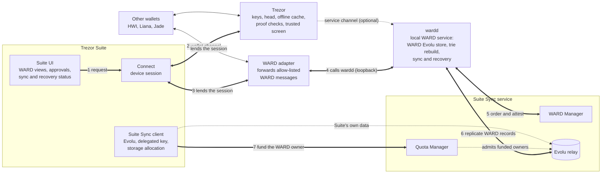

# WARD architecture

WARD is a Trezor-centered authenticated, encrypted key-value store for wallet metadata such as
address labels. Hosts store the encrypted entries and replicate them through an Evolu relay. A
WARD Manager (WM) orders changes across devices. The Trezor keeps only its keys, a small offline
cache and, per passphrase wallet, a **head**: a change counter and the root of the authenticated
trie. Every read, write and history step is checked against that head on the device.

Read this page before the task pages. The design docs in [`docs/ward`](../index.md) are
authoritative; this page only summarizes them.

## Components and trust

| Component | Trust | Role |
| --- | --- | --- |
| Trezor | Trusted | Derives keys and `entry_key`s, seals and opens leaves, verifies proofs, history and WM attestations, holds the head, shows every decision on its screen. |
| Suite UI | Untrusted | Starts WARD operations, shows outcomes the device verified, and presents pending edits, synchronization state and recovery choices ([H6](h6-suite-ward-ux.md), [S1](s1-suite-backup-ux.md)). |
| Connect (in Suite) | Untrusted | Owns the device session (PIN, passphrase, buttons) and lends it to the WARD adapter for each WARD operation. |
| WARD adapter | Untrusted | One shared, I/O-free forwarding adapter, bound into Connect and into HWI, Liana and Jade; the only way a wallet reaches wardd. It calls wardd and carries wardd's device requests and the Trezor's replies over the borrowed session, passing only allow-listed WARD messages and interpreting none of them ([H1](h1-wardd-host-adapter.md)). |
| Suite Sync client (in Suite) | Untrusted | Suite's Evolu client. Holds the device's delegated Suite Sync key, fetches the wallet's Evolu node, from which wardd's WARD owner is derived, and allocates storage for that owner from the device's quota ([H7](h7-ward-storage-on-suite-sync.md)). |
| Other wallets | Untrusted | HWI, Liana and Jade play Connect's role: they own the device session and lend it to the same WARD adapter, which calls wardd. |
| wardd | Untrusted | Local service outside Suite, shared by every wallet. Stores sealed leaves, transition records and kept WM attestations in an Evolu store under a WARD owner separate from Suite's data; rebuilds the trie to serve proofs; coordinates publication, sync and recovery. Never decides what the device adopts. |
| Evolu relay | Untrusted | Replicates encrypted records between hosts. Admits only owners the Quota Manager has funded. |
| Quota Manager | Untrusted | Grants relay storage from the device's quota on a request signed with the delegated key. Learns that an owner exists and its size, nothing else. |
| WARD Manager | Ordering and freshness only | Keeps the latest step (predecessor and head) per wallet, accepts one successor per head and signs attestations with its clock. Sees `ward_id`, counters, roots and session timing, never entries or `entry_key`s. |

**The flow through Suite** (bold arrows):

1. The Suite UI asks Connect for a WARD operation: a lookup, a write, a sync or a flush.
2. Connect holds the device session on the wallet channel.
3. Connect lends that session to the WARD adapter.
4. The adapter calls wardd. wardd drives the conversation: each message it sends to the Trezor and
   each reply (a proof request, a history step, a signed result) passes through the adapter on
   Connect's session. Neither the adapter nor Connect interprets them.
5. For a sync or a write, wardd obtains the WM's challenge and attestation and submits the
   wallet-authorized step; the Trezor checks the WM's signature itself.
6. wardd stores each transition in its Evolu store, which the relay replicates to the wallet's other
   hosts.
7. Suite Sync keeps the WARD owner funded at the Quota Manager, so the relay accepts those records.

The Trezor adopts a result only after its own checks, and the Suite UI shows what the device
reported, never what a host claims.

Participants and channels are defined in [ward-channels.md](../ward-channels.md); what each party
learns is in [threat_model.md](../threat_model.md).

## Invariants

1. **The device is the only judge.** A host or WM signature alone never moves the head. Adoption
   needs wallet-authorized history that descends from the stored head (exact counter and root).
2. **Keyed, sealed leaves.** `entry_key = HMAC-SHA256(K_path, "WARD PATH v1" || leaf_identity)`.
   The leaf holds `sealed_content`; `sealed_identity` is stored beside it. Both are sealed with
   AES-256-GCM, bound to `entry_key` in the AAD. The global key set is `K_path`, `K_ident`,
   `K_data`; per-application `K_data(app)` is envisioned. See
   [ward_leaf_encryption.md](../ward_leaf_encryption.md).
3. **Proof before decryption.** Every value and every absence is verified against the trusted root
   before it is opened or acted on. Roots are derived on the device from verified proofs, never
   taken from the host. See [ward-trie.md](../ward-trie.md).
4. **Monotonic counter.** A commit advances the counter by its number of changes (1 to 8); a revert
   advances it by exactly 1 and ends the write session. See
   [ward_transitions.md](../ward_transitions.md).
5. **One successor per head.** The WM accepts a step only if it starts at its current head and is
   signed for the active write session.
6. **Store before publish.** wardd stores a transition and its sealed changes in Evolu before
   submitting it to the WM, so the writing host can rebuild every head it gets accepted.
7. **The WM keeps no history.** It holds only the latest step and no timestamps. Append-only
   transition records and kept WM attestations live in wardd and Evolu.
8. **User-mediated recovery.** Rejoin, roll-forward and revert each require confirmation on the
   Trezor; nothing silently discards local or published changes.

## Main flows

### Lookup

The device derives `entry_key` and asks wardd for the sealed leaf and its proof. A membership proof
is opened with `K_data`; a non-membership proof yields "not found". A pointer entry is followed once,
within the same application. The screen marks the result as current (proven against a head the WM
attested in this session), not checked as current (older head or offline copy) or pending. See
[lookup](../ward_leaf_encryption.md#lookup) and [user stories](../user_story.md).

### Write and batch publication

1. The device verifies the old entry, or its absence, at head M and the user approves the edit. The
   edit joins the device's pending queue.
2. On flush, the device folds 1 to 8 queued changes into one transition, verifying each against the
   root produced by the preceding one, and emits the sealed changes, a wallet authentication tag
   (`K_auth`) for other devices and a signature for the WM's active session. The device stays at M.
3. wardd stores the record, submits it, and receives the WM's signed receipt for head N.
4. The next sync adopts N and settles the queue. A write that lost a race is resolved with a retry
   token: re-sign, no-op or a conflict screen.

See [from approval to adoption](../ward_transitions.md#from-approval-to-adoption) and
[competing writers](../ward_transitions.md#competing-writers).

### Sync and catch-up

A sync opens a write session: the device signs the WM's single-use challenge with a fresh nonce,
and the WM attests its current step bound to that nonce. If the device is at M and the WM at N > M,
wardd supplies the wallet-authorized steps and the device walks back from N to its exact M. wardd
serves N only after tracing the chain back and replaying it forward, checking every intermediate
root. When the WM is unreachable, a kept attestation gives a dated read position for the session;
the user may opt to persist it. See [catching up](../ward_manager.md#catching-up-a-second-trezor)
and [what a verified read means](../threat_model.md#what-a-verified-read-means).

### Recovery

- **Rejoin.** The device is on a losing branch. It verifies the last common state and the user
  confirms how much local history to discard.
- **Roll-forward.** A WM restored from backup is behind the device. wardd offers the missing steps
  with their kept WM records; after approval the device releases fresh authorizations and the WM
  advances as far as the records reach.
- **Attested revert.** The WM is at N but hosts can rebuild only M < N. The user approves one
  revert N to N + 1 with M's root, backed by a kept attestation of M.
- **Late changes.** Re-adding changes that arrive after a revert and closing the dead branch are
  proposed.

See [ward_roll_forward.md](../ward_roll_forward.md) and
[recovery after data loss in Evolu](../ward-trie.md#recovery-after-data-loss-in-evolu).

## Task map

| Component | Tasks |
| --- | --- |
| Device offline cache, backup and migration | [F1 Offline cache in miniscript](f1-offline-cache.md), [F8 Migration from the miniscript store](f8-migration.md) |
| Entry identity, keys and sealing | [F2 Authenticated entries](f2-authenticated-entries.md), [F3 Confidential entries](f3-confidential-entries.md) |
| Trie verification on the device | [F4 Merkle trie](f4-merkle-trie.md) |
| History, heads and freshness | [F5 Chain history verification](f5-chain-history.md), [F6 Firmware freshness and latest counter](f6-freshness.md) |
| Pending queue, batches, reverts and recovery | [F7 Rollback and batching](f7-rollback-batching.md) |
| Dedicated service channel | [F9 Service channel](f9-service-channel.md) |
| WARD adapter in Connect and the other wallets, wardd routing | [H1 wardd and host adapter](h1-wardd-host-adapter.md) |
| Host trie and history rebuild | [H2 Host trie reconstruction](h2-host-trie.md), [H3 History reconstruction](h3-history-reconstruction.md) |
| WARD Manager | [H4 WARD manager service](h4-ward-manager-service.md) |
| wardd sync, publication and recovery | [H5 wardd online sync](h5-wardd-online-sync.md) |
| Evolu storage and quota | [H7 WARD storage on Suite Sync](h7-ward-storage-on-suite-sync.md) |
| Suite UI and Suite Sync client | [H6 Suite WARD UX](h6-suite-ward-ux.md), [S1 Suite backup UX](s1-suite-backup-ux.md), [H7 WARD storage on Suite Sync](h7-ward-storage-on-suite-sync.md) |

## Open questions

- **Submit after local store or after relay acknowledgment.** Waiting for the relay shrinks the
  window in which the WM holds a head no other host can rebuild, at the cost of availability.
- **Device slot exhaustion.** When per-wallet head storage is full, the device must fail closed or
  ask the user, never evict silently. The policy is open.
- **Settle, then save.** Settling the queue and storing the new head are separate writes; the fix
  for a power cut between them is open ([gaps](../gaps.md#publication-and-reads)).
- **Per-application data keys.** When to move from the global key set to `K_data(app)`.
- **Dead branches.** Whether to adopt re-adding and closure records for changes that arrive after a
  revert.
