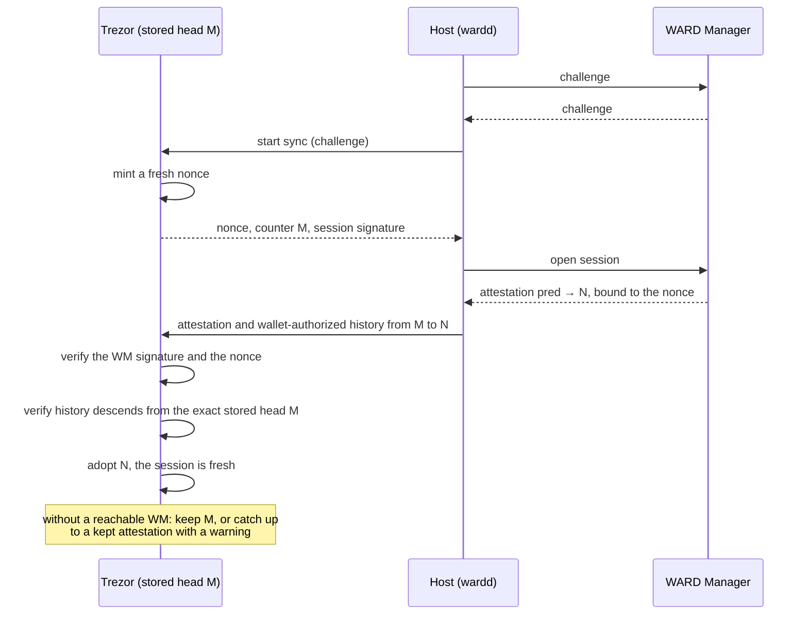

# F6 Firmware freshness and latest counter

Chain history ([F5](f5-chain-history.md)) proves that a head descends from one the Trezor trusts,
but not that it is current: a host can serve an older, genuine tree. F6 adds freshness. The device
stores a trusted head per wallet, and the WARD Manager (WM) attests, against a nonce the device has
just minted, the transition that reached its current head. The device adopts that head only when
wallet-authorized history connects it to the stored one
([what a verified read means](../threat_model.md#what-a-verified-read-means)).

Trust boundary and invariants:

- The device trusts only its keys and its stored head. Hosts are untrusted transport and storage.
- The WM is trusted for ordering and freshness only. It sees counters and roots, never entries, and
  could sign a root the wallet never held, so a WM signature alone never moves the head.
- The WM keeps only the latest step per wallet and no timestamps; it signs with its clock at
  signing time. The date the device keeps is for display ("Manager-signed date"), never a
  freshness floor.
- Writes require a WM-confirmed session. Without a reachable WM the device can only catch up, with
  a warning, to a head named by a kept WM attestation.

## F6.1 Implement durable per-wallet trusted heads

For each passphrase wallet, persist the last adopted head (counter and root) as one sealed value
keyed by a device-local wallet identifier, so root and counter always come from one adoption. A
fixed number of slots serves all wallets.

- The empty tree and "no root" are distinct states. "No root" means "cannot verify": reads are
  refused rather than reported verified, and writes are refused at every counter. Treating it as
  empty would let a host replace the whole tree.
- The head moves only by adoption ([F6.4](#f64-implement-synchronized-head-reconciliation)) or a
  permitted catch-up. No host message sets it, and signing a write does not move it.
- The counter is the anti-rollback floor. It may drop only through a revert the user approved while
  the WM was behind, bound to that exact transition and the stored counter it was approved from
  ([F7.4](f7-rollback-batching.md#f74-authorize-reverts-with-monotonic-counters)).
- Sync state (round, freshness, provisional head, approvals) is session-only.
- With all slots taken, adoption is refused and the wallet works offline. Heads are never evicted,
  since that would reset another wallet's floor.

## F6.2 Implement nonce-bound WM attestation verification

Decide whether a statement is the WM's attestation of one transition, for this wallet, answering
the challenge this device just issued.

- Opening a sync round mints a fresh random nonce kept in the session and discards any unfinished
  round, so only the latest nonce can be answered and stockpiled attestations cannot be replayed.
  Opening a round clears the session's freshness. The reply reports the device's counter, plus the
  root and enrollment signature at counter zero only.
- The attestation signs, under a domain and version, the device nonce, the wallet's public
  identity, the predecessor and successor heads, and the WM's signing time. Naming the predecessor
  lets the device pin the exact link. The identity binds it to one wallet.
- Check the shape before the signature: counter zero must be the genesis self-transition; any
  other step advances by one to eight
  ([counter rules](../ward_transitions.md#why-commits-count-changes-and-reverts-count-one)).
- The WM public key is built into firmware; a test key is accepted only on debug builds. An
  all-zero key or signature is always refused.
- A verified attestation is recorded in the session even if adoption is refused. Its date is not
  checked against a clock; nonce and counter provide replay protection.
- Checked against a host-supplied stored nonce, an attestation proves only historical acceptance
  (catch-up, recovery), never freshness.
- Any malformed or unverifiable input fails the request with nothing persisted.

## F6.3 Sign wallet-authorized transitions for the WM

Let the WM accept a write only from a seed holder, in the current write session, on its current
head. One preimage (kind tag, wallet identity, both heads) gets two authenticators, minted together
so they always name the same step:

- the **wallet authentication tag** (HMAC under a seed-derived key), which other devices of the
  wallet use to verify history ([F5](f5-chain-history.md));
- the **public signature** (Ed25519 under the wallet signing key) over the preimage plus the
  session nonce, which the WM verifies with the wallet identity alone.

- **Sessions** ([sessions](../ward_transitions.md#sessions)). The device signs the WM's single-use
  challenge with its own fresh nonce; the WM consumes it and replaces the wallet's previous write
  session (a read-only attestation leaves it in place). The device signs authorizations only in a
  session with a verified attestation. The WM accepts a step only if its predecessor equals the WM
  head, it advances by one to eight, and the signature verifies under the session nonce.
- **Enrollment** is signed only at counter zero; a later one would let the first device to reach an
  empty WM pin an older head.
- **Freshness.** Signing clears the session's freshness and persists nothing; the outcome is learned
  on the next sync ([from approval to adoption](../ward_transitions.md#from-approval-to-adoption)).
  A lost race uses the [retry token](../ward_transitions.md#competing-writers).

## F6.4 Implement synchronized head reconciliation

Turn a verified attestation into an adopted head only when wallet history connects it to the stored
head, and define what reads may claim. The host picks a route; the device proves it:

- **One link.** Operands come from the attestation; the host adds only the wallet tag. Accepted:
  same head (nothing moves, the session becomes fresh), exactly one link from the stored head, or
  the exact demotion the user approved.
- **Chain walk** back from the attested head to the stored head
  ([F5.2](f5-chain-history.md#f52-implement-complete-chain-verification-and-adoption)), whose first
  link starts at the attested predecessor. Diverged histories need a
  [rejoin](../ward_roll_forward.md#reverting-and-rejoining).
- **WM behind.** An attested head below the stored counter is not adopted; the round records it,
  enabling roll-forward.

Adoption order: settle claims by the transitions crossed, persist the head (with the date only if
the attestation names it), mark the session fresh, spend any demotion approval, close the round. A
head reached across a revert shows a warning.

**Read freshness.** A read is fresh only if this session adopted a WM-attested head and has not
signed since. Other reads carry a warning that, when a date is known, shows the Manager-signed date
and says later changes and reverts may be missing. Writes need freshness: on the wallet channel the
host syncs first; on the [service channel](f9-service-channel.md) the device drives one sync.

**Without a live WM** ([catching up a second Trezor](../ward_manager.md#catching-up-a-second-trezor)),
the host offers a head with a cached attestation. The device requires a non-fresh session, an
offered counter not below the stored one, a valid signature over the host-supplied stored nonce, a
walk that lands on the stored head, and an equal root at equal counters. By default the result is a
session-only read position, never fresh. A per-wallet option, enabled and withdrawn on the device
with a held confirmation, persists it and settles claims; the session still is not fresh. In the
MVP without a WM the chain alone decides and the head is persisted.

## F6.5 Reject stale counters, roots and attestations

Keep stale state, replayed attestations and orphaned links from moving the head. Every refusal
happens before any persistent write.

| Check | Refuses |
| --- | --- |
| A live attestation answers the open round's nonce; a new round discards the old; adoption closes the round. | Archived attestations, earlier rounds, reuse in a second adoption. |
| Adoption requires an attested round. | Links, walks or rejoins without fresh attestation. |
| Genesis is the empty tree attesting itself; other steps advance one to eight. | Malformed genesis, zero-length or oversized steps. |
| An attested head below the stored counter is not adopted, except the exact approved demotion. | A regressed WM or older head. |
| Equal counters need equal roots. | Another tree at the device's counter. |
| Links chain exactly from the stored head (one link) or attested predecessor (walk) and land on the stored counter. | Orphaned links and batch links that jump the stop. |
| Each link's wallet tag verifies as commit or revert, in constant time. | Forged or relabeled history. |
| Claims settle by verified wallet tags of crossed links, never by counter. | Another device's change counted as this device's write. |
| Service channel: the publication attestation names the device's own step under that publication's nonce; a WM below the device fails the sync. | Attestations of other steps; adoption from a regressed WM. |

Accepted limits ([threat model](../threat_model.md#accepted-security-limitations)): a restored WM
can repeat a head, a host can withhold accepted changes, and a device without a stored head accepts
any genuine head.

## F6.6 Verify atomic updates and power-loss recovery

Show that an interruption never mixes root and counter from different heads, lowers the floor, or
strands a queued change.

Persisted: the head (on adoption and persisted catch-up only), one claim per offered change, the
persistence setting and host pins. Session state is never persisted. Required ordering:

- A claim is written before its record is flagged offered and before anything leaves the device;
  a batch checks room for all claims first. A cut in between leaves a harmless unused claim.
- Settlement runs before the head write; a cut between them is the known
  [settle-then-save gap](../gaps.md#publication-and-reads).
- A cut during the head write must yield the old head, the new head or a detected storage fault,
  never a missing slot read as "counter zero, no root".
- Walks write nothing until complete. An unreadable claim warns first; declining aborts adoption.

After restart: root and counter belong to one adoption; the counter is not lower unless an approved
demotion completed; every offered record has a claim; after a sync each queued change has landed
once or is offerable again.

## Open questions

- How to close the settle-then-save window (adoption target journal, single transaction, or
  from-state in each claim; see [gaps](../gaps.md#publication-and-reads)).
- Whether replacing a sealed storage value can be made atomic, or whether a torn write must always
  surface as a storage fault.

## Related

- [WARD Manager](../ward_manager.md), [transitions and sessions](../ward_transitions.md),
  [recovering manager history](../ward_roll_forward.md)
- [Threat model](../threat_model.md) and [security gaps](../gaps.md)
