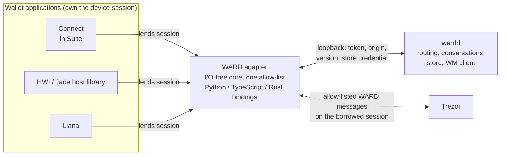
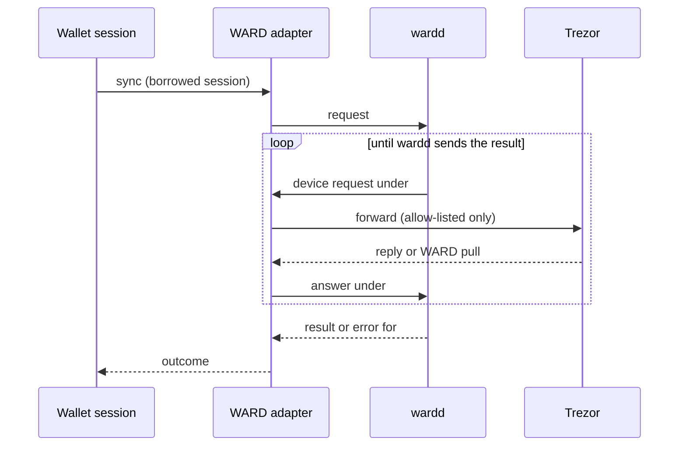

# H1 wardd and host adapter

**Depends on:** nothing.

wardd, the local WARD service, holds all host-side WARD logic: the local Evolu store, the WARD
Manager client and the order of every exchange with the Trezor. On the
[wallet channel](../ward-channels.md#wallet-channel) only the wallet application holds the device
session, so wardd reaches the device only through a forwarding adapter on that session. The
application lends the session and forwards messages but decides nothing about WARD. The device
trusts neither party; their mistakes make entries unavailable but cannot corrupt device state.

- **Borrowed session.** The adapter never opens or releases a session. A sync and its flush share
  one session, because the device keeps sync state per session. User prompts stay with the host;
  WARD pulls go back to wardd.
- **Strict pairing.** One operation per wallet at a time, one outstanding device request per
  client request. An unexpected, mistyped, duplicate or late reply fails the request and closes the
  connection.
- **One allow-list.** Only allow-listed WARD messages reach the device.
- **Credential isolation.** The Evolu node secret stays in the wallet application; wardd gets only
  a derived store credential over loopback, after origin, pairing-token and version checks.
- **Degradation.** Without wardd or the adapter, WARD reports unavailable and the wallet still works.

One shared I/O-free Rust adapter (H1.2) has Python (H1.3) and TypeScript (H1.4) bindings and is
attached to Jade's host library, Connect and Liana with minimal glue. All bindings replay one
recorded conversation corpus. The [dedicated service channel](f9-service-channel.md) is out of
scope, but H1.1's lifecycle rules apply to it.

One conversation, as the adapter carries it. wardd decides every step; the adapter only forwards
and the wallet keeps PIN, passphrase and button prompts.

## H1.1 Implement wardd request routing and conversation lifecycle

wardd listens on loopback for allowed origins. A client presents the pairing token and protocol
version, then opens one wallet's store with its public identifier and store credential. Each
request carries a client-chosen number and is either local (status, a single-entry proof for a host
driving its own device call, storing and publishing a write result) or a conversation (sync,
catch-up, flush), in which wardd sends device requests under that number, device pulls are ordinary
answers, and one result or error ends it.

Each request starts from a fresh rebuild of the local store; requests for one wallet are
serialized; answers are type-checked against the expected step; a write is stored before it is
published, so the manager never advances to a head no host holds. Per-reply and per-conversation
deadlines bound a stalled client: on expiry, or on a reused active number, wardd fails the request
and closes the connection. A disconnect cancels pending device requests and releases the wallet.
An unreachable manager is its own error, and the device keeps its head.

## H1.2 Build the shared Rust forwarding adapter

Build one I/O-free state machine for the forwarding contract. Given frames from wardd it emits one
action at a time: send to the device, send to wardd, or finish. It holds only the next request
number, the active request and the allow-list. Messages are a name plus a JSON body, so the core
needs no WARD definitions; an optional codec encodes them for raw-frame transports. The host
supplies a device pipe on its session (prompts handled as usual, WARD pulls returned unanswered)
and a socket, or uses the driver's.

The allow-list covers every exchange wardd drives, including catch-up and roll-forward, and nothing
else. Every device request gets exactly one reply; pipe errors return as failures. A lost socket
fails the call, and the next sync replaces any open round on the device. A version mismatch is
refused at the handshake.

## H1.3 Add Python bindings and Jade host integration

Wrap the core in a native Python extension with synchronous operations: open, sync, flush, catch
up, status, an entry provider for pulling calls, and applying a write result. The pipe is a Python
callable on the caller's session. Release the interpreter lock while waiting on wardd; turn pipe
exceptions into failure replies; raise one exception type carrying the error code. Without a native
build, report WARD unavailable.

For Jade's host library, the glue is one pipe function mapping a message name and body onto Jade's
RPC through its session, plus open after unlock, sync and flush.

## H1.4 Add TypeScript bindings and Connect integration

Compile the core to WebAssembly with a platform-socket driver, so one build serves browser,
extension, Node and mobile. In Connect, a forwarding method lends the device for one conversation;
for ordinary entry calls, a provider answers pulls from wardd and rebuilds the cumulative set of
staged changes for a batch. Connect's driver normalizes absent fields, which its decoder returns as
nulls and empty objects.

Connect forwards only allow-listed requests. The forwarding method needs the management permission,
plus the public-key permission to fetch the Evolu node. The caller chooses the wardd endpoint, which
then receives the store credential, so the allow-list bounds what a malicious endpoint can make the
device do. A failed module load fails WARD calls only.

## H1.5 Connect the adapter to Liana host sessions

Contribute a Trezor backend to Liana's Rust hardware-wallet library, then run the adapter natively
on Liana's async runtime with three pieces of glue: a pipe on the backend's session that returns
pulls unanswered; a hook routing pulls in ordinary entry calls to the adapter's entry provider; and
open on wallet open, sync and flush on Liana's session. Liana keeps the session and every prompt,
and the adapter never blocks its runtime. A locked or disconnected device fails the request; an
unreachable wardd disables WARD features only.

## Open questions

- **Store access.** Should the pairing token alone let a second client use a store another client
  opened?
- **Python packaging.** Should platforms without a native build get a corpus-checked pure-Python
  implementation, or report WARD unavailable?
- **Connect bundle.** Does WebAssembly fit Connect's content security policy and bundle budget?
- **Jade.** Is WARD support in Jade firmware in scope?
- **Liana transport.** Must the Liana backend support the paired host channel newer Trezors need?

## Related

- [Sessions](../ward_transitions.md#sessions) and
  [competing writers](../ward_transitions.md#competing-writers)
- [What each party learns](../threat_model.md#what-each-party-learns)
- [Access and display](../gaps.md#access-and-display)
