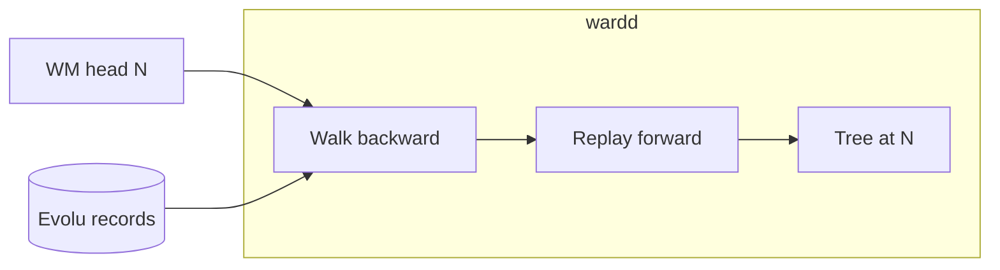

# H3 History reconstruction

**Depends on:** [H2 Host trie reconstruction](h2-host-trie.md) and
[F5 Chain history verification](f5-chain-history.md).

The WARD Manager attests a head but keeps only the latest step, with no entries or history. Evolu
holds the records, including dead branches. From the authoritative head and those records, wardd
builds a tree it can serve and supplies the chain the device walks in [F5](f5-chain-history.md).
Like the device, the host walks backward from the head so each record is pinned to an established
state (H3.1), then replays forward from a trusted anchor (H3.2). Record selection is untrusted: the
device verifies every wallet tag. When the records cannot reach the head, the host reports that it
is behind ([recovery after data loss in Evolu](../ward-trie.md#recovery-after-data-loss-in-evolu)).

- **Walk backward (H3.1):** from N, follow each record's predecessor to an anchor.
- **Replay forward (H3.2):** apply each step's changes and check every intermediate root.
- **Edge cases:** a record that does not reproduce its root is left out and another path is tried;
  a cycle or a missing record means no path reaches N, and the host reports that it is behind.

## H3.1 Walk backward from the authoritative head

The authoritative head is the manager's current head; if the manager is unreachable, the newest
buildable head a kept manager attestation vouches for
([catching up a second Trezor](../ward_manager.md#catching-up-a-second-trezor)); in the
manager-free build, the highest head whose chain reaches the empty tree at counter zero.

Index records by resulting state. From the head, take a record ending exactly there and continue
from its starting state, until an anchor: counter zero or a local checkpoint for a rebuild, the
device's stored counter for a device walk. When several records end at one state, prefer one whose
chain reaches the anchor (for a device walk, through the device's stored state). Send the chain
newest first, in pages sized to the device's buffer
([evidence for each step](../ward_roll_forward.md#evidence-for-each-step)).

Before indexing, reject records that do not advance by one to eight, or by exactly one for a revert
([counter rules](../ward_transitions.md#why-commits-count-changes-and-reverts-count-one)), so every
walk strictly descends. Keep dead branches for [rejoin](../ward_roll_forward.md#reverting-and-rejoining)
and [late changes](../ward_roll_forward.md#changes-that-arrive-after-a-revert). A broken chain makes
the sync fail as "behind"; a forged record only costs availability.

## H3.2 Replay selected history and check intermediate roots

Replay the chain forward from its anchor, applying each record
([H2.3](h2-host-trie.md#h23-apply-stored-insert-update-and-delete-transitions)) and checking the
rebuilt root against the record's resulting root. A revert restores the tree at its target and
advances the counter by one. A mismatching record is dropped and counted, and the head falls back
to the next one that builds. Replay is deterministic, runs in memory over a fixed snapshot of the
record set, and checks every intermediate root, so a bad record is located exactly. Missing records
leave the user to wait or [revert to an attested state](../ward_roll_forward.md#reverting-to-an-attested-state).

**Local checkpoints.** The host may save a verified tree it replayed itself as an anchor above
zero. Checkpoints are written whole, never replicated, and their root is recomputed before use. A
peer's snapshot is never an anchor: a root does not cover the sealed identities beside the leaves.

## Open questions

- **Long replays.** A large replay holds the wallet
  ([recovery and availability](../gaps.md#recovery-and-availability)). Are checkpoints enough, or
  should replay run in the background while requests report "behind"?

## Related

- [Transitions and sessions](../ward_transitions.md)
- [Recovering manager history](../ward_roll_forward.md)
- [What a verified read means](../threat_model.md#what-a-verified-read-means)
