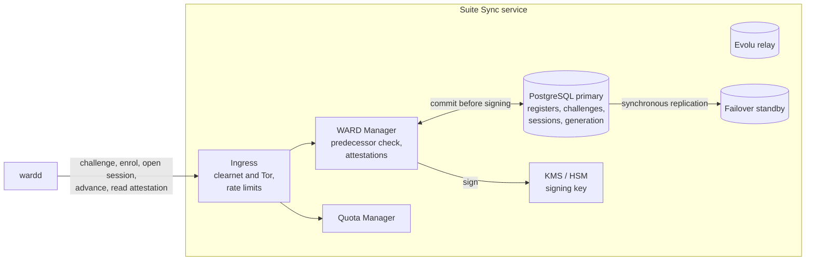
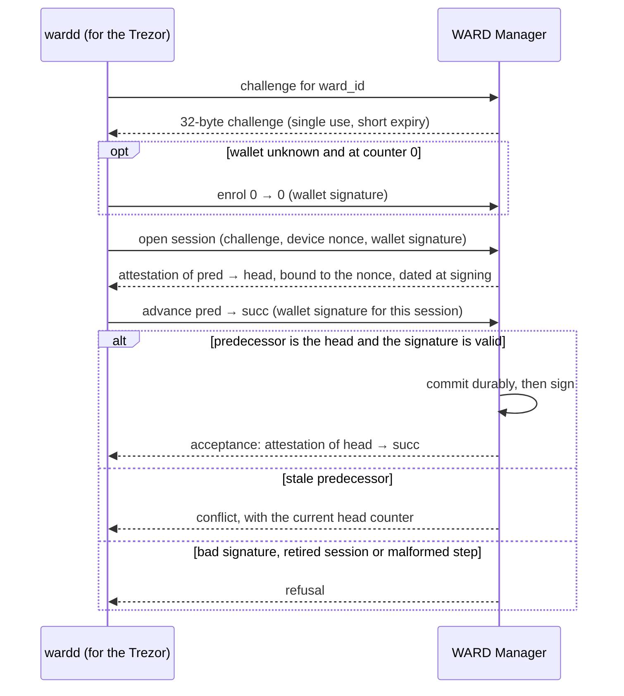

# H4 WARD manager service

**Depends on:** [H2.4](h2-host-trie.md#h24-match-host-roots-and-proofs-against-firmware)

The [WARD Manager](../ward_manager.md) orders wallet-authorized transitions and attests heads. It
accepts a transition only when it starts at the stored head (the predecessor check) and the wallet
signed it for the active write session. On request it signs the step that reached its head, bound
to the device's fresh session nonce and dated with its clock at signing time
([transitions and sessions](../ward_transitions.md)). It runs as its own process in Suite Sync
beside the Quota Manager, sharing its server setup, PostgreSQL, health and metrics, image and
ingress (clearnet and Tor). Its wire semantics and preimages are the ones firmware verifies
([F6.2](f6-freshness.md#f62-implement-nonce-bound-wm-attestation-verification),
[F6.3](f6-freshness.md#f63-sign-wallet-authorized-transitions-for-the-wm)).

**Trust boundary.** The manager is trusted for ordering and freshness only. It sees the ward id
(the wallet's Ed25519 public key), counters, roots, signatures and session timing, never entries,
entry keys or wallet tags ([what each party learns](../threat_model.md#what-each-party-learns)). A
compromised manager can sign a root the wallet never held, withhold service, pick the winning
writer, present a restored register, or give a device with no stored head an old head. It cannot
forge a wallet authorization, read or change entries, or move a device's stored head without
wallet-authorized history descending from it ([F6](f6-freshness.md)).

- **Latest step only.** Per wallet: predecessor → head, no timestamps, no history. History lives in
  wardd and Evolu.
- **Keyed by ward id**, never by the Evolu owner. Rotating the Evolu owner neither creates a second
  register nor resets the counter; wardd carries records and kept attestations into the new owner.
- **Durable before signed.** A transition is committed durably, including on the failover standby,
  before anything about it is signed. Unready or stale instances sign nothing.
- **One successor per head.** Each acceptance raises the counter: by one to eight for a commit,
  by exactly one for a revert.
- **Distinct outcomes.** *Conflict* (stale predecessor; device retries), *refusal* (bad
  authorization, retired session, malformed step) and *unavailable* (database error, timeout, rate
  limit; device keeps its head and warns).

| State | Holds |
| --- | --- |
| Register, per wallet | Predecessor and head (counter, root); created at genesis 0 → 0 with the empty tree |
| Challenge, per wallet | 32 random bytes, generation, short expiry; single use |
| Session, per wallet | Device nonce, generation; a new opening replaces it |
| Generation, per deployment | Integer raised on every restore |

The exchanges of one write session. The device signs every wallet statement; wardd only carries
them.

## H4.1 Build service routing configuration and health checks

Run the manager as a separate Suite Sync process and deployment on the shared image and server setup
(permissive origins, since Suite can be self-hosted; version ban; sanitizing; schema validation).
Expose versioned, wallet-scoped routes for head query, challenge, enrollment, session opening,
read-only attestation and advance, under a path prefix on the existing public host. Enforce small
body limits and exact field lengths before storage or signing code.

Configuration fails closed: database, signing-key reference, expected public key and environment
are required, and production refuses to start without a provisioned key, with the debug key, or
with a key that does not match ([H4.8](#h48-provision-service-signing-and-firmware-trust-keys)).
An instance is ready when the primary database answers, migrations are complete, the key matches
and the generation matches the database
([H4.9](#h49-implement-backup-restore-and-stale-instance-protection)); a failed save makes it
unready. Registers live only on the primary. A database outage returns "unavailable".

## H4.2 Persist wallet heads and transition history

Keep one register row per wallet, keyed by the 32-byte ward id: predecessor and head counters and
roots. Enrollment creates it at genesis. Roots are stored in preimage form, so the empty tree is its
fixed constant, never a missing value. No time is stored; wardd keeps the signed records.

Persist no earlier steps, acceptance records, wallet tags, entries, host identities or times:
history comes from wardd, and a manager-side history would add retention and privacy cost without
security. Challenges and sessions live apart and must not survive a restore
([H4.7](#h47-implement-head-nonce-rotation-and-recovery-generations)). Decision logs are diagnostic
only. A row changes only by enrollment or an accepted advance, both ends atomically; the head
counter never decreases within one database history. A failed write rolls back and signs nothing.

## H4.3 Prevent conflicting head updates

Process an advance in one transaction: lock the wallet's row, verify the signature under the
session nonce ([H4.4](#h44-verify-wallet-transition-signatures)), compare the predecessor counter
**and root** with the stored head, check the step size (one to eight for a commit, exactly one for
a revert), write the new row, commit, and only then sign the acceptance record
([H4.5](#h45-sign-fresh-challenge-bound-head-attestations)). The row lock serializes one wallet
across all instances. A conflict names the head counter; wardd treats it as a lost race for the
device's [retry token](../ward_transitions.md#competing-writers). Enrollment creates a row only if
none exists, repeats succeed without change, and it never replaces a register above genesis. A
lock timeout is retried once, then reported as unavailable.

## H4.4 Verify wallet transition signatures

Every wallet statement verifies under the ward id, a SLIP-21-derived Ed25519 key; no other wallet
key is enrolled. Three statements:

- **Enrollment:** the genesis self-transition under an enrollment tag, with no session nonce.
- **Session opening:** domain, ward id, the manager's challenge and the device nonce.
- **Advance:** a commit or revert tag, ward id, predecessor and successor counters and roots, and
  the active session nonce. A commit signature never verifies as a revert, or the reverse.

Every operand acted on is inside the verified bytes. Verification is strict: exact lengths,
canonical encodings, no all-zero signature or small-order key. The manager-free MVP's host-facing
tag is never accepted. Refusals name the cause without echoing secrets. The manager cannot check
wallet tags, so it may accept a step other devices cannot verify
([chain evidence](../gaps.md#publication-and-reads), accepted).

## H4.5 Sign fresh challenge-bound head attestations

Sign the fixed-width, versioned preimage of
[F6.2](f6-freshness.md#f62-implement-nonce-bound-wm-attestation-verification): device nonce, ward
id, predecessor and head (counter, root) and the manager's clock time at signing. Signing a step,
not a bare head, lets the device pin the first link of its walk. Sign on session opening (new
session nonce), read-only attestation (caller's nonce, session unchanged) and acceptance (session
nonce; wardd keeps it as [roll-forward evidence](../ward_roll_forward.md#evidence-for-each-step)).

Sign only what the register holds, read in the transaction that locked or committed it, never
host-supplied values, and nothing for a wallet without a row. Freshness is the device's judgment:
it accepts only its open round's nonce. A signer error after commit fails the request; the host
learns the outcome on the next sync.

## H4.6 Expose ordered history and idempotent retries

Ordered history is served by wardd from Evolu, not by the manager. This task makes every answer safe
to repeat:

| Operation | Repeated |
| --- | --- |
| Challenge | Same challenge until consumed. |
| Enrollment | No change; succeeds. |
| Session opening | Refused; new challenge and new sync. |
| Read-only attestation | Signs again. |
| Advance equal to the latest step, same session | Succeeds with a fresh acceptance record; nothing moves. |
| Advance after the head moved, or in a later session | Conflict or refusal. |

Once the head moves on, the manager cannot sign a record for an older step, so wardd keeps every
attestation it obtains
([H5.2](h5-wardd-online-sync.md#h52-persist-candidates-before-wm-publication-and-finalization)); an
attestation of N serves as the record for M → N with a later date
([recovery date](../gaps.md#recovery-and-availability)). The device settles lost responses by
wallet tag, never by counter
([F7.3](f7-rollback-batching.md#f73-implement-batch-confirmation-and-cancellation)).

## H4.7 Implement head nonce rotation and recovery generations

There is no head nonce. A write session opens when the Trezor signs the manager's single-use
challenge with its fresh nonce, and every write authorization binds to that nonce
([sessions](../ward_transitions.md#sessions)). Opening verifies the proof, consumes the challenge
atomically, installs the session and returns a live attestation, all under the wallet's row lock.
Opening replaces the previous session, ending its unlanded authorizations; a read-only attestation
does not. A session can carry several transitions, as roll-forward does; a device revert ends it.

**Recovery generation.** Kept in deployment configuration and the database, and stamped on
challenge and session rows. A restore raises it; older rows are refused and purged; an instance with
a mismatched generation is unready. It is never signed.

## H4.8 Provision service signing and firmware trust keys

- **Custody.** Generate and use the production Ed25519 key inside a KMS/HSM; it never exists in
  process memory, configuration or backups. Fallback: a sealed secret injected at start, never a
  text seed. The manager holds no wallet key.
- **Trust.** Firmware compiles in the public key, and wardd pins it. Release firmware trusts only
  the production key; debug firmware also the published debug key. All-zero keys and signatures are
  refused. Clients never trust a fetched key.
- **Environments.** Development and staging use the debug key or a staging key trusted only by debug
  builds. The production key never leaves production.
- **Rotation.** Firmware carries the current and next key, so the service can switch once devices
  update. A leaked key acts as a compromised manager for every wallet; revocation needs a firmware
  release.

## H4.9 Implement backup restore and stale-instance protection

Commit first, sign after the commit returns, and require commits to be durable on the standby that
failover promotes; a lost commit counts as a restore.

A restore to a backup at M puts a wallet at N back to M, drops wallets enrolled later and ends all
sessions. A device at N keeps its head and helps the manager [roll forward](../ward_roll_forward.md);
a wallet without a row re-enrolls at genesis and rolls forward. If new writes land first, devices
need a [rejoin](../ward_roll_forward.md#reverting-and-rejoining); a device with no stored head
accepts the older head ([accepted limitations](../threat_model.md#accepted-security-limitations)).

**Restore procedure:** stop all instances, restore, raise the generation, purge sessions and
challenges, start, and watch roll-forward rates; wardd coordinates devices
([H5.5](h5-wardd-online-sync.md#h55-implement-fork-rejoin-and-recovery-coordination)). Stale
instances (a forgotten clone, a lagging standby, a second deployment) must not sign: only production
holds the production key, each signing transaction checks the generation on the primary, and
registers are never read from a standby.

## H4.10 Deploy staging with health metrics and limits

Deploy a staging overlay mirroring production (own database and staging key), first with one
instance, then two.

- **Metrics.** Enrolled wallets from the read-only replica; per instance, requests by outcome,
  session openings, commit and signing latency, failed saves. Alert on failed saves, unready
  instances, generation mismatch and rising conflict or unavailable rates.
- **Privacy.** No ward id, root or nonce in metric labels; logs hold at most a shortened ward id,
  briefly, and never join it with client addresses beyond short retention
  ([what each party learns](../threat_model.md#what-each-party-learns)).
- **Limits.** Body and field limits on every request; rate limits per address and per ward id;
  short challenge expiry; server timeouts below Suite's client timeout. wardd treats a rate limit as
  unavailable, so the device keeps its head and warns.

## Open questions

- **Check order.** Verify the signature before the predecessor check, so unauthorized callers get
  uniform refusals? The head query already reveals the counter.
- **Unauthenticated reads.** Anyone knowing a ward id can poll its head. Are rate limits enough?
- **Forensics.** Is an acceptance log kept apart from backups worth its longer retention of ward ids
  and roots?

## Related

- [Catching up a second Trezor](../ward_manager.md#catching-up-a-second-trezor)
- [Recovering manager history](../ward_roll_forward.md)
- [Threat model](../threat_model.md) and [security gaps](../gaps.md)
