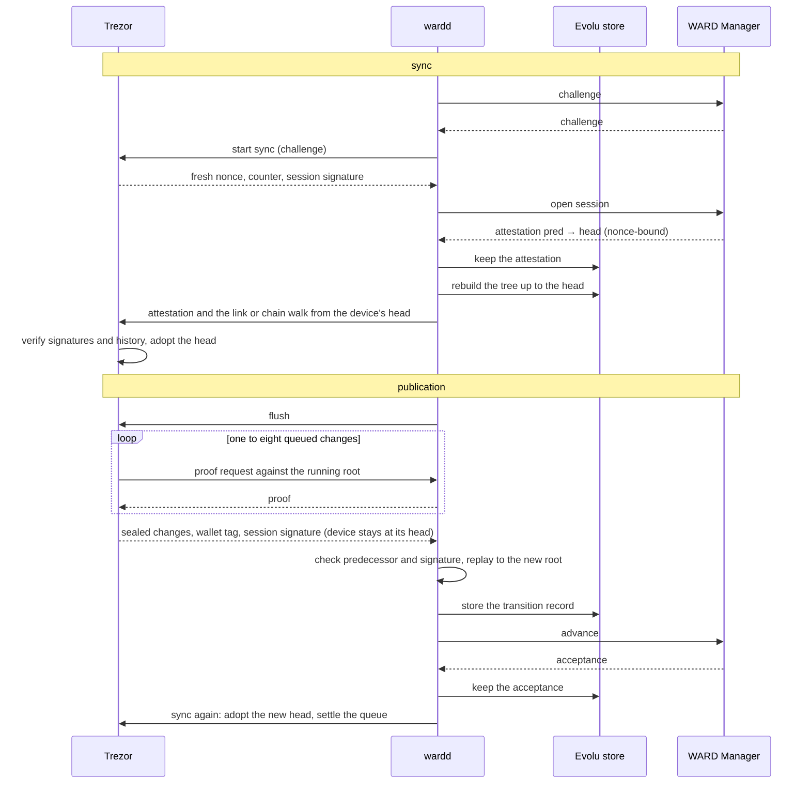

# H5 wardd online sync

**Depends on:** [H4](h4-ward-manager-service.md), [F6](f6-freshness.md), [H3](h3-history-reconstruction.md)

wardd is the host half of [F5](f5-chain-history.md), [F6](f6-freshness.md) and
[F7](f7-rollback-batching.md): on the [wallet channel](../ward-channels.md#wallet-channel) it drives
the Trezor through sync, publication and recovery against the WARD Manager (WM) and Evolu. The
device trusts only its keys and stored head, the WM only for ordering and freshness, and the host
not at all. wardd never decides what the device adopts; it decides what to offer, in which order,
and what to keep so the next offer is possible.

- **Append-only store.** Per wallet, wardd keeps transition records in Evolu, each written once
  under an identity derived from its transition and carrying all encrypted entry changes of its
  step, plus the WM signed records it relayed. Nothing is updated, deleted or flagged final: a step
  is current only because the WM head points at it.
- **Stateless rebuild.** No mutable tree or cursor. Every operation walks rows back from the target
  head, replays them forward and checks each root; rows that do not reproduce their root are left
  out. One operation per wallet at a time, under per-reply and overall deadlines.
- **Store before publish.** No transition reaches the WM before its whole record (one to eight
  changes) is durably stored.
- **Advisory versus verified.** Unsigned WM reads and the local Evolu view only guide rebuilding
  and status. Only the Trezor screen labels a read current
  ([showing an address label](../user_story.md#showing-an-address-label)).

| Situation | wardd offers |
| --- | --- |
| Device at the attested step or one behind | One link into the head |
| Device further behind | Chain walk from local rows, newest first, in pages |
| WM unreachable | Device keeps its head; catch-up on request |
| Lost write race | Sync, then retry with the device's retry token |
| Device on another branch | Rejoin on request |
| WM restored behind the device | Roll-forward with kept WM records |
| Host cannot build the WM head | Wait for Evolu, or a user-approved revert to an attested state |
| Late rows after a revert | Re-add review and branch closure (design) |

A sync followed by a batch publication. Every arrow to the Trezor passes through the
[WARD adapter](h1-wardd-host-adapter.md) on the wallet's session.

## H5.1 Integrate authoritative WM heads into synchronization

Make the WM head the target of every live sync. Per [sessions](../ward_transitions.md#sessions),
wardd fetches the WM's single-use challenge; the device returns a fresh nonce, its counter and a
signed session-opening statement (plus root and enrollment signature only at counter zero, the only
case in which wardd enrolls a wallet). wardd forwards the statement, keeps the WM's nonce-bound
attestation, hands it to the device ([F6.2](f6-freshness.md#f62-implement-nonce-bound-wm-attestation-verification))
and picks the route above. The device sees only heads the WM signed in this round.

Distinguish "no answer" (network, timeout, server error) from "answered no" (conflict with the WM
counter, or refusal). With no answer the device keeps its head and the caller may request a
**catch-up** to the newest buildable state with a kept WM record. It is a read position for the
session unless the user allowed persisting cached heads
([what a verified read means](../threat_model.md#what-a-verified-read-means)). Without a WM (MVP),
sync catches up to the highest buildable head and the device persists it. A host that cannot build
the WM head reports "host behind" (H5.6).

## H5.2 Persist candidates before WM publication and finalization

Never let the WM advance to a head no host can serve
([from approval to adoption](../ward_transitions.md#from-approval-to-adoption)). Check that the
device built on the locally built head and signed exactly this step in the open session; replay the
changes; durably append one record with the step, its wallet tag, the publication signature and
every entry change; submit; on acceptance keep the WM's signed record (newest per step), which
[roll-forward](../ward_roll_forward.md#evidence-for-each-step) needs; then sync so the device adopts.

Failures: a failed append submits nothing. A failed predecessor check or an ended session leaves a
dead row and its own outcome; the caller syncs and the change is offered again or retried with the
[retry token](../ward_transitions.md#competing-writers). A crash or unreachable WM before
submission leaves a stored row; the next sync opens a new session. A reply lost after acceptance is
settled by the next sync, and a later attestation of the step serves as its record
([recovery gaps](../gaps.md#recovery-and-availability)).

## H5.3 Resume device catch-up after disconnection

The device [restarts an interrupted
walk](f5-chain-history.md#f53-add-bounded-history-transfer-and-interruption-handling) and persists
nothing before adoption, so wardd resumes the operation, not the stream: a new call opens a new
round with a fresh nonce and plans again from rows, WM head and the device's report. Nothing from
the interrupted attempt is reused as evidence. An interrupted roll-forward continues from the
counter the WM reached, with a new approval; an interrupted publication is adopted by the next sync
or offered again.

On a deadline wardd closes the client connection so a late reply cannot answer a later
conversation, rejects pending device calls and releases the wallet. A queued call whose caller left
is cancelled.

## H5.4 Expose pending edit batch and revert operations

Queued edits live on the device ([F7.1](f7-rollback-batching.md#f71-implement-persistent-pending-edit-management)).
wardd offers:

- **Publish the queue:** sync, ask the device for its next transition (one change or a batch of up
  to eight), serve each proof against the running root, store and submit (H5.2), sync so claims
  settle, repeat until empty, with a round limit.
- **Publish one write:** serve proofs to a caller driving the device, then store and submit.
- **Lost race:** report the WM counter; the caller syncs and retries with the retry token.
- **Revert:** for a buildable target M with a kept WM record, open a fresh session and ask the
  Trezor to approve N to N + 1 with M's root; a revert advances the counter by exactly one and
  removes no rows. Approval ends the write session, so wardd stores and submits it, then syncs
  again to adopt it.

The device chooses and folds the batch; wardd never reorders changes. A refused proof stops the
batch before anything is filed; a revert that loses the predecessor check is approved again on the
new head.

## H5.5 Implement fork rejoin and recovery coordination

The user decides every discard on the Trezor ([F7.5](f7-rollback-batching.md#f75-implement-fork-and-missing-history-recovery)).

- **Rejoin** ([reverting and rejoining](../ward_roll_forward.md#reverting-and-rejoining)): find the
  device's branch as the only root at its counter off the WM history and offer the fork point on
  request; with none or several, report that the fork cannot be named.
- **Roll-forward:** when the WM is restored to M below the device at N, replay up to the newest kept
  record whose chain passes exactly through M, in bounded pages on fresh attestations, the device
  signing each step again. If records stop at K, the WM reaches K and stays behind the device.
- **Revert to an attested state** ([design](../ward_roll_forward.md#reverting-to-an-attested-state)):
  when the host cannot build N, report N and the newest buildable kept state M, and revert on request.
- **Re-add and closure (design):** report a [dead branch](../ward_roll_forward.md#changes-that-arrive-after-a-revert)
  of late rows (fork point, head, N − M), serve its proofs, publish re-added entries as commits and
  store the device's [closure record](../ward_roll_forward.md#closing-a-dead-branch).

A WM signature alone authorizes nothing; a host can still choose among genuine branches after
repeated restores ([accepted limitations](../threat_model.md#accepted-security-limitations)).

## H5.6 Expose synchronization status and recovery actions

Report two separate things. The **host view** (advisory): locally built head, newest kept WM record,
WM head and reachability, manager-free mode, host behind, rows left out. The **device-verified
outcome**: route, adopted head, changes discarded, roll-forward summary, catch-up signed time and
persistence, reverts crossed, published and remaining counts. Each outcome names its recovery action
(catch up, retry with token, sync again, wait for records, rejoin, revert to an attested state,
re-add), and each action plans again from current state so it can be repeated. Status carries
counters and roots, never entries, and a host that is behind serves no entries as current.

## Open questions

- Should catch-up be an automatic fallback? It would hide that the result is a session-only read.
- Should storing wait for relay replication? It shrinks the
  [late-writer window](../ward-trie.md#recovery-after-data-loss-in-evolu) at the cost of availability.
- Should wardd resubmit a stored step while its session and predecessor are still current?

## Related

- [Transitions and sessions](../ward_transitions.md), [WARD Manager](../ward_manager.md#catching-up-a-second-trezor)
  and [recovering manager history](../ward_roll_forward.md)
- [Threat model](../threat_model.md) and [security gaps](../gaps.md)
