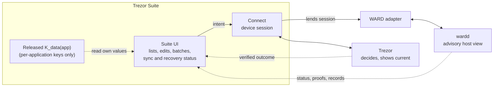

# H6 Suite WARD UX

**Depends on:** [H5](h5-wardd-online-sync.md), [F3](f3-confidential-entries.md),
[F7](f7-rollback-batching.md), [S1](s1-suite-backup-ux.md); H6.7 also on [H2](h2-host-trie.md),
H6.8 also on [F4](f4-merkle-trie.md).

H6 is the Suite surface for the replicated WARD: listing, key release, editing, pending batches,
sync state, recovery and manual restore. Per [participants and channels](../ward-channels.md), the
Trezor holds keys and the adopted head, verifies every proof and asks the user; wardd stores and
serves proofs and is untrusted; Suite presents state, collects intent and relays device–wardd
exchanges on the [wallet channel](../ward-channels.md#wallet-channel), holding the WARD application
role on the paired Trezor Host Protocol.

- **Suite checks, the device decides.** Suite verifies proofs and opens leaves only to inform the
  user and reject bad material early; the device repeats every check.
- **Only the device says "current".** Suite shows an entry as current, landed or restored only when
  the device said so in this session, and labels wardd's reports as such.
- **Keys.** WARD starts with one global key set ([keys](../ward_leaf_encryption.md#keys)); the device
  releases none of it, so leaves are read on the device. Reading leaves in Suite (H6.1, H6.2, H6.6,
  H6.7) assumes per-application keys.
- **Confidentiality.** Identifiers, values, application names, plaintext leaves and keys never
  reach analytics, crash reports, logs or any remote endpoint; errors carry only kind and step.

## H6.1 List WARD entries and applications

Show the wallet's entries grouped by application, from the device's offline listing (names, state
and size, no values; [F1.3](f1-offline-cache.md#f13-add-listing-and-storage-capacity-handling)),
from a walk of the verified trie with an application key
([listing and restore](../ward_leaf_encryption.md#listing-and-restore)), and without a key from
entries Suite can name, read one by one through the device. States: **current** (proven against a
head adopted from a live WM attestation this session), **not checked as current** (older or cached
head, or pinned copy), **pending**, **unreadable**.

A walked group is complete only if its rebuilt root equals the root the device reported this
session ([F4.8](f4-merkle-trie.md#f48-listing-of-all-or-filtered-entries)). A missing identity
shows as unnamed, one that does not derive its path as invalid; pointers are shown, not followed.

## H6.2 Request application keys

Release one application's key to Suite after the user confirms that application on the device
([F3.3](f3-confidential-entries.md#f33-release-application-keys-on-demand-post-mvp)). Suite first explains
that the holder can read the application's entries and history without the Trezor, irrevocably,
and warns when the application is not Suite's own. The key stays in memory for the session unless
the user chooses to remember it under Suite's platform credential encryption; it never leaves the
computer and authorizes nothing. A compromised Suite after release exposes the application's whole
history; the [threat model](../threat_model.md#what-each-party-learns) must record this. A locked
device, missing role or declined screen returns no key, and Suite names which.

## H6.3 Manage WARD entries

Show an entry's details and the head it was proven against, and let the user add, change or delete
it. Edits follow [from approval to adoption](../ward_transitions.md#from-approval-to-adoption);
Suite reports confirmed, published and adopted, never "done" before adoption. Without a live sync
the edit is queued on the device ([F1.2](f1-offline-cache.md#f12-implement-offline-add-update-delete-and-lookup)).
A deletion leaves any pinned copy, and Suite says so. On a lost race Suite relays the retry
([competing writers](../ward_transitions.md#competing-writers)); a lost reply shows the edit as
unknown until the next sync. Full store, oversized value and missing role get distinct messages.

## H6.4 Review pending edits and batches

List what waits on the device and let the user:

- **Publish** singly or as one batch of up to eight
  ([F7.2](f7-rollback-batching.md#f72-prepare-and-validate-batch-transitions)); a batch lands or
  fails whole and advances the counter by its number of changes. Only the first change can raise a
  conflict, which mirrors the device's choices
  ([F7.3](f7-rollback-batching.md#f73-implement-batch-confirmation-and-cancellation)).
- **Discard** with a hold on the device; this does not revoke an authorization a host already holds.
- **Revert** to a buildable target M below head N, approved with a hold
  ([F7.4](f7-rollback-batching.md#f74-authorize-reverts-with-monotonic-counters)). The revert
  restores M's root at N + 1, advancing the counter by exactly one, and ends the write session; a
  new sync adopts it.

A change is landed only when an adoption crossed its own transition. An interrupted batch stays
pending and is offered again.

## H6.5 Show synchronization and recovery actions

Show the device-verified state (adopted head; live, cached with signed date, or manager-free; reverts
crossed) apart from wardd's advisory view
([H5.6](h5-wardd-online-sync.md#h56-expose-synchronization-status-and-recovery-actions)). Suite
syncs once per WARD session; the user can retry.

| Situation | Action offered |
| --- | --- |
| WM unreachable | Catch up to a cached attestation ([F5.4](f5-chain-history.md#f54-offline-sync-corner-cases)) |
| WM behind the device | [Roll forward](../ward_roll_forward.md), or wait for the missing records |
| Diverged histories | [Rejoin](../ward_roll_forward.md#reverting-and-rejoining) |
| Host behind the WM | Wait (default), or [revert to an attested state](../ward_roll_forward.md#reverting-to-an-attested-state) |
| Late changes after a revert | [Re-add](../ward_roll_forward.md#changes-that-arrive-after-a-revert) and [close the branch](../ward_roll_forward.md#closing-a-dead-branch) (design) |
| Records not replicating | Show the reason ([H7.4](h7-ward-storage-on-suite-sync.md#h74-handle-quota-exhaustion-and-refusal)) and allocate storage ([H7.2](h7-ward-storage-on-suite-sync.md#h72-allocate-and-account-quota-for-ward-records)) |

Waiting is the default because no host can tell a late change from a lost one
([late writers](../gaps.md#recovery-and-availability)). Before a revert Suite repeats that the
N − M later changes leave the current state (exact unless a revert lies between).

## H6.6 Decrypt selected WARD leaves

Open leaves the user selected, only after H6.7 proved them, with the released key as in
[listing and restore](../ward_leaf_encryption.md#listing-and-restore): a content that fails to open
belongs to another application and is skipped. Names come from the device's listing: the identity
key never leaves the device. A leaf
from an earlier root shows that root's counter and is not current. Plaintext stays in memory for
the session. A malformed part or unknown scheme marks the leaf invalid and
excludes it from restore.

## H6.7 Verify Merkle proofs before manual restore

Check each selected leaf's membership proof with the host trie ([H2](h2-host-trie.md)) against the
head the device reported this session, never a root from wardd; a cached root is labeled with its
signed date, and a leaf from an earlier root awaits device verification. Restore stays blocked while
the proof fails, no device root exists, or the host is behind. Proofs are never stored. Suite's
check saves time; the device's ([F4.2](f4-merkle-trie.md#f42-implement-membership-proof-verification))
is the one that counts.

## H6.8 Manually restore entries into the offline queue

Restore entries that passed H6.6 and H6.7 as pinned copies or pending changes, one request per
entry, after checking room against the listing. The device reads, verifies and shows the leaf
itself ([F4.6](f4-merkle-trie.md#f46-restore-verified-leaves-into-the-offline-queue)); Suite never
sends a value. A restored pending change publishes later as a new change, never a revert. Outcomes
per entry: restored, unchanged, declined, refused with reason, or no room. After a broken session
Suite rereads the listing.

## Open questions

- Should the device refuse keys for applications other than the requester's?
- Restoring from an earlier root and the base counter of a restored change are open in
  [F4.6](f4-merkle-trie.md#f46-restore-verified-leaves-into-the-offline-queue).

## Related

- [Entry privacy](../ward_leaf_encryption.md), [transitions](../ward_transitions.md) and
  [recovering manager history](../ward_roll_forward.md)
- [User stories](../user_story.md), [threat model](../threat_model.md) and [security gaps](../gaps.md)
