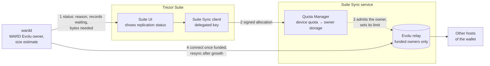

# H7 WARD storage on Suite Sync

**Depends on:** [H4](h4-ward-manager-service.md) (the same Suite Sync service) and
[H5](h5-wardd-online-sync.md).

wardd keeps a wallet's WARD records in an Evolu owner of its own, derived from the wallet's Evolu
node and separate from Suite's data. The Suite Sync relay replicates it between hosts, but admits
only owners the Quota Manager has given storage and accepts writes only within it. H7 funds the
WARD owner as Suite funds its own and makes missing storage visible.

- wardd never holds the device's delegated Suite Sync key. It reports what the WARD owner needs;
  the key holder (Suite) allocates storage from the device's quota.
- A relay refusal never fails or undoes a local write: the record is stored and published, and
  waits. Meanwhile other hosts are behind the manager, as after a
  [late writer](../gaps.md#recovery-and-availability).
- The Quota Manager learns only that the device has a WARD owner and its size
  ([what each party learns](../threat_model.md#what-each-party-learns)).

## H7.1 Register the WARD owner with the Quota Manager

Reuse Suite's device registration (the device's delegated key signs a single-use challenge); add no
second device identity. The host derives the WARD owner secret from the wallet's Evolu node,
which the device releases to the key holder, and hands it to wardd; wardd reports the owner's public
identifier. The Quota Manager needs no
WARD-specific change: the first signed allocation (H7.2) registers the owner. One owner per wallet,
so all its devices fund the same one. A device not registered with Suite Sync is reported as such.

## H7.2 Allocate and account quota for WARD records

Records only grow: late records, dead branches and kept manager records all stay
([recovery after data loss in Evolu](../ward-trie.md#recovery-after-data-loss-in-evolu)). wardd
estimates the stored size and reports the bytes needed; the key holder allocates with the same
signed allocation Suite uses for its own owner. Policy: fixed increments, allocate again before the
remainder drops below a reserve, and never take the last part of the device's quota, which stays
for Suite's own data. A refusal for lack of device quota is shown with the storage used.

## H7.3 Configure wardd's relay endpoint and credentials

Select relay and Quota Manager together from the environments Suite uses (local, staging,
production). The owner's keys never go to the Quota Manager. A permissive development relay is an
explicit separate choice; production never falls back to it. An unreachable relay reports "not
replicating".

## H7.4 Handle quota exhaustion and refusal

Status reports whether records reach other hosts and, if not, the reason (no storage, storage used
up, relay unreachable), the records waiting and the bytes needed; Suite shows it
([H6.5](h6-suite-ward-ux.md#h65-show-synchronization-and-recovery-actions)). wardd connects the
owner to the relay only once the Quota Manager reports storage for it, since an unfunded owner is
turned away and reconnects with growing delays. The relay does not ask for refused records again,
so wardd starts a full resynchronization when storage grows after a refusal. No record is deleted
and no head moves; the user never repeats a write.

## Related

- [Participants and channels](../ward-channels.md) and [security gaps](../gaps.md#recovery-and-availability)
