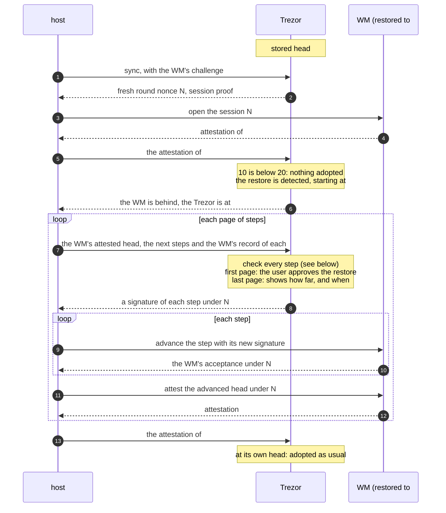
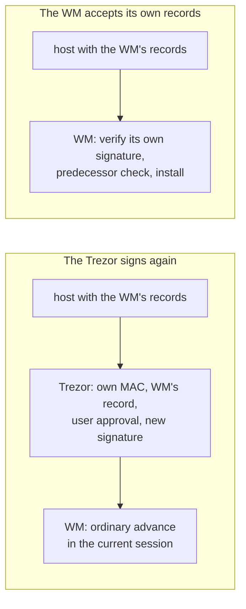

# WARD roll-forward

A WM whose register goes back no longer holds transitions it accepted. That happens after a
restored backup, a failover onto a stale replica, or a lost register. Roll-forward brings the WM
back to its newest head. A Trezor of the wallet signs the accepted steps again for its current
session, and the host submits them to the WM as ordinary advances.

The Trezor's original WM signatures cannot be reused. Each is bound to the session it was made in,
and a restore ends every session. After a session ends, nobody can tell a stored signature for an
accepted step from one for a lost race (see
[a stored signature cannot be verified later](ward_transitions.md#consequence-a-stored-signature-cannot-be-verified-later)).
So roll-forward starts from what only the WM produced: its signed records of the steps it
accepted.

## Overview

1. **The Trezor detects the restore** during an ordinary sync.
2. **The host feeds it the accepted steps**, each with the WM's record of it, a page at a time.
3. **The Trezor checks every step**, the user approves once, and the Trezor signs each step again
   for its current session.
4. **The host submits the signatures** to the WM as ordinary advances.
5. **The Trezor shows the result**: how far the history was restored and when the WM last
   confirmed its last step.

## Detection

The Trezor, not the host, decides that the WM was restored. When a sync attests a head below the
Trezor's stored head, the Trezor neither adopts it nor fails. It reports that the WM is behind,
with its own counter, and remembers the detection for this round, with the WM's head as the
starting point. The round stays open, but nothing can be adopted from it. Without that detection,
the Trezor refuses to sign anything again.

A Trezor that is not ahead of the restored WM, such as a fresh one, does not detect the restore and
adopts the WM's head as usual.

## The records

A WM record is any attestation the WM signed for exactly that step:

- **The acceptance of an advance.** It is signed under the session nonce and dated when the WM
  accepted the step.
- **An attestation from a later sync.** It is signed under that sync's nonce while the step was
  the head, and dated then.

Either way, the timestamp is when the WM vouched for the step; the WM itself keeps no time. The
host keeps one verified record per step, replicated with the links. The newest record replaces an
older one for the same step, so the kept time is the latest at which the WM vouched for that step.

## What the Trezor checks

Each page carries the WM's live attestation of its current head, under the round nonce of the
session the Trezor opened in this sync, and a run of steps, each with the Trezor's own MAC of it
and the WM's record of it.

The Trezor considers a step valid only if **both** of its checks pass:

1. **Its own MAC.** The MAC verifies under `K_auth`, so a Trezor of this wallet made the step. A WM
   cannot sign itself a history.
2. **The WM's signature.** The record verifies under the WM key over exactly this step, so the WM
   accepted it. A lost race or a publication held back has no record.

It also checks two things about the chain:

- **Contiguity.** The first step starts at the attested head, and each step starts where the
  previous one ended. A later page starts where the previous page ended.
- **Its own history.** No step jumps over the Trezor's stored counter, and a step that starts or
  ends at the stored counter has the stored root there. The Trezor re-authorizes history it is on,
  and steps beyond its head that continue from it; never a branch it would refuse.

It then signs each step again for the current session, keeping its kind: a revert stays a revert.

## What the user sees

- **Approval.** On the first page, after checking it, the Trezor shows "Restore WARD history":
  the WM's change number, its own, and how many changes that page signs again. Later pages of the
  same round need no new approval. Declining signs nothing, and the WM stays where it was
  restored to.
- **Result.** On the last page it shows "WARD history restored": the change number reached and,
  as "Last confirmed", the time of the WM's record of the last restored change, in UTC: when the
  WM last vouched for it, as far as the host's records go. The user can compare it with when they
  last made a change.

The user confirmed each change when it was made, and the WM accepted it. The approval is for the
restore itself: re-binding history the WM had lost to the current session.

## What the host does

The host coordinates; it decides nothing the Trezor or the WM does not check. When the Trezor
reports during a sync that the WM is behind, the host:

- **Finds the path.** From its replica it picks the newest accepted head it holds a WM record
  for, and the chain of steps that leads there from the WM's current head. If no such chain
  starts at the WM's head, the WM is on another branch: that is a rejoin, not a roll-forward.
  The path ends at the first step the host has no record for.
- **Relays it.** It hands the path to the Trezor in pages, with the WM's records, and submits the
  signatures the Trezor returns to the WM as ordinary advances. Between pages it has the WM
  attest its advanced head again, so each page starts where the WM now stands.
- **Finishes the sync.** Once the WM is back at the Trezor's head, the sync continues as usual
  and the Trezor adopts its head. The host reports how far the history was restored and when the
  WM last confirmed it.

Any refusal, by the Trezor or the WM, or a declined approval, ends the roll-forward where it is;
a Trezor still ahead of the WM then fails the sync. Roll-forward runs on the wallet channel only.

## Who re-admits the history

A restored WM has lost steps it once accepted, and something must put them back. There are two
ways, and they differ in who vouches for each step:

- **The Trezor signs again (chosen).** The Trezor checks each step against its own MAC and the
  WM's record, and signs it for the current session. The WM takes it as an ordinary advance.
- **The WM accepts its own records (not chosen).** The host presents the WM's records to the WM.
  The WM verifies its own signature over each step, checks the predecessor, and installs it. No
  Trezor is involved.

| | The Trezor signs again | The WM accepts its own records |
| --- | --- | --- |
| Ways into the WM | One: a Trezor-signed advance in the current session | Two: that, and a replay of its own records |
| Who checks a step | The Trezor (its own MAC) and the WM (its record) | The WM alone |
| A WM bug or a stolen WM key | Cannot invent history: no wallet MAC | Reinstalls whatever its key signed |
| Who can drive it | Only a connected Trezor, with the user's approval | Anyone holding the records, with no device present |
| Expiry | The new signatures expire with the session | The records never expire |
| Prefix choice | The record holder chooses where to stop | The same, and without any Trezor involved |
| Availability | Needs a Trezor that is ahead of the restored WM | Works with no Trezor connected |
| Cost | A MAC check, a record check and a signature per step, on the device | One signature check per step, on the WM |

The chosen way keeps the WM's single way in and puts every re-admitted step in front of the
wallet's own key. The price is availability: until a Trezor that is ahead connects and the user
approves, the restored WM stays behind. Neither way removes the prefix choice; see below.

## What stays open

- **Prefix choice (accepted gap).** Whoever holds the records chooses how far the WM is replayed,
  and after two restores also which branch. The WM then attests an old genuine head as current.
  Trezors whose stored counter is past it refuse it; a fresh or rarely synced Trezor accepts it.
  See [WM restore and roll-forward](gaps.md#wm-restore-and-roll-forward).
- **Open findings** in [gaps.md](gaps.md):
  [freshness after detected regression](gaps.md#freshness-after-detected-regression),
  [roll-forward consent and completion](gaps.md#roll-forward-consent-and-completion) (the
  approval counts only the first page, and the final screen shows before the host submits the
  signatures), [recovery dates](gaps.md#recovery-dates), and
  [recovery through relay clients](gaps.md#recovery-through-relay-clients).
- **A wallet the WM lost entirely** has no head to roll onto. Re-enrollment needs the Trezor's
  genesis authorization, which only a Trezor at counter 0 supplies.
