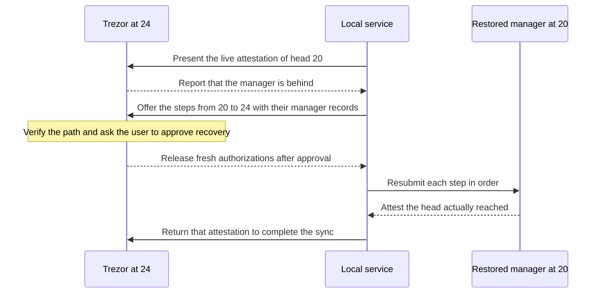

# Recovering manager history

Suppose a Trezor remembers change 24 and a restored manager reports change 20. The device keeps its
stored head. On the wallet channel, a compatible host can ask it to help the manager recover the
missing steps.

## Evidence for each step

The host supplies a continuous path from the manager's restored head. For each step the Trezor
checks the wallet authentication tag and a signed manager record for the same predecessor and
successor. The tag proves a wallet device authorized the step, including whether it was a revert.
The manager record rules out writes that lost a race or were never submitted.

The path cannot skip the device's stored counter and must match its root if it reaches that
counter. Recovery uses fresh write authorizations because restoring the manager ends its previous
session. The manager checks each predecessor, and the host obtains a fresh attestation.

## What the user approves

The first screen shows the manager's and device's positions and the number of changes on the first
page. The Trezor requests user approval and releases recovery signatures to the host. 
The screen shows the last step prepared for submission and the date
the manager last confirmed it. A subsequent live sync establishes how far the manager advanced.
For example, if the host has records only through change 22, the manager can advance to 22.
The device at 24 still reports that the manager is behind. The steps accepted up to 22 remain in place.

## Reverting and rejoining

A **revert** restores a verified historical root under a new counter. The Trezor checks the validity 
of the previous transition and the manager's historical evidence before asking for a confirmation. 
If the manager has regressed due to restore, the rollback requirement may be undetected.

A **rejoin** switches between diverging histories. The Trezor verifies their last common state and
asks the user to confirm how much local history to discard before adopting the manager's branch.
In future release, the Trezor can add pending transitions to WARD and re-add these (based on user confirmation) 
once they become available in wardd / evolu.
