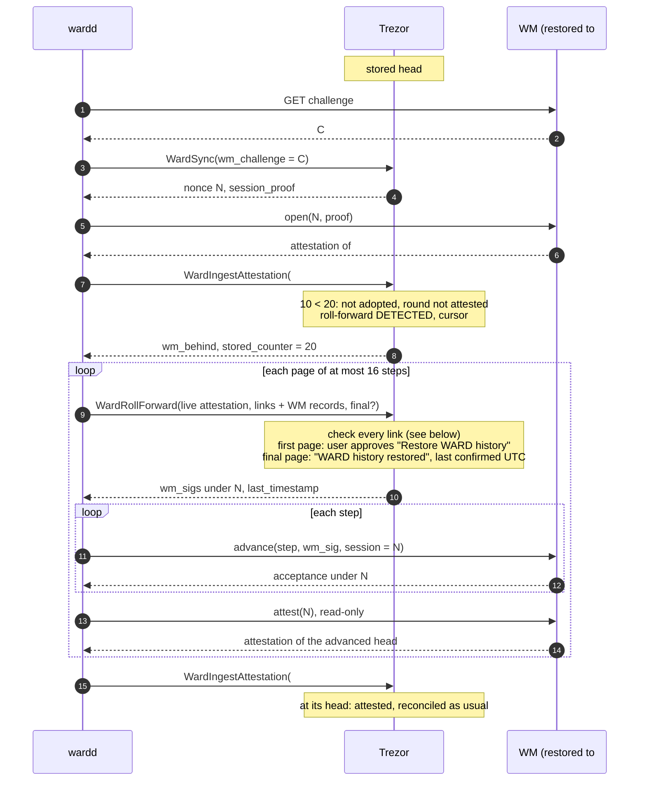
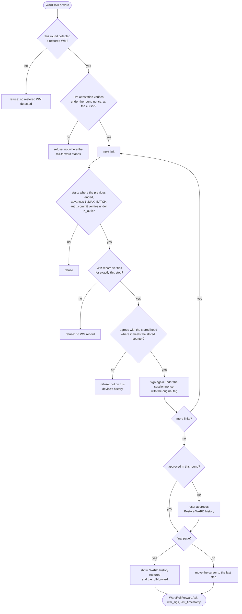
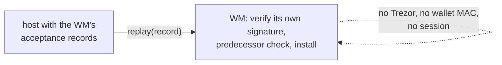

# WARD roll-forward

A WM whose register goes back no longer holds transitions it accepted. That happens after a
restored backup, a failover onto a stale replica, or a lost register. Roll-forward brings the WM
back to its newest head. A Trezor of the wallet signs the accepted steps again for its current
session, and wardd submits them to the WM as ordinary advances.

The Trezor's original signatures cannot be reused. Each `wm_sig` is bound to the session it was
minted in, and a restore ends every session. After a session ends, nobody can tell a stored
`wm_sig` for an accepted step from one for a lost race (see
[a stored signature cannot be verified later](ward_transitions.md#consequence-a-stored-signature-cannot-be-verified-later)).
So roll-forward starts from what only the WM produced: its signed records of the steps it
accepted.

## Overview

1. **The Trezor detects the restore** during an ordinary sync.
2. **wardd feeds it the accepted steps**, each with the WM's record of it, in pages of at most 16.
3. **The Trezor checks every step**, the user approves once, and the Trezor signs each step again
   under its session nonce.
4. **wardd submits the signatures** to the WM as ordinary advances.
5. **The Trezor shows the result**: how far the history was restored and when the WM last
   confirmed its last step.

## Detection

The Trezor, not wardd, decides that the WM was restored. When `WardIngestAttestation` attests a
head below the Trezor's stored head, the Trezor neither adopts it nor fails. It answers
`wm_behind` with its stored counter, and records the detection for this round
(`round.ROLL_FORWARD_DETECTED`, with the WM's head as the cursor). The round stays open but is not
attested, so nothing can be adopted from it. The Trezor refuses `WardRollForward` in a round
without that detection.

A Trezor that is not ahead of the restored WM, such as a fresh one, does not detect the restore and
adopts the WM's head as usual.

## The records

A WM record is any attestation the WM signed for exactly that step:

- **The acceptance from `advance`.** It is signed under the session nonce and dated when the WM
  accepted the step.
- **An attestation from a later sync.** It is signed under that sync's nonce while the step was
  the head, and dated then.

Either way, the timestamp is when the WM vouched for the step; the WM itself keeps no time. wardd
keeps one verified record per step (`StoredAttestation`, replicated through Evolu with the links).
The newest record replaces an older one for the same step, so the kept time is the latest at which
the WM vouched for that step.

## What the Trezor checks

Each `WardRollForward` message carries:

- the WM's live attestation of its current head, against the round nonce of the session the
  Trezor opened in this sync;
- each transition with its `auth_commit` and the WM's record of exactly that step
  (`WardChainLink.acceptance`).

The Trezor considers a transition valid only if **both** of its checks pass:

1. **Its own MAC.** The `auth_commit` verifies under `K_auth`, so a Trezor of this wallet made the
   step. A WM cannot sign itself a history.
2. **The WM's signature.** The record verifies under the WM key over exactly this step, so the WM
   accepted it. A lost race or a publication held back has no record.

It also checks two things about the chain:

- **Contiguity.** The first step of the round starts at the attested head, and each step starts
  where the previous one ended. A later page starts where the previous page ended ("not where the
  roll-forward stands" otherwise).
- **Its own history.** No step jumps over the Trezor's stored counter, and a step that starts or
  ends at the stored counter has the stored root there. The Trezor re-authorizes history it is
  on, and steps beyond its head that continue from it; never a branch it would refuse.

It then signs each step again under the session nonce, with the step's original tag: a revert
stays a revert. It returns the signatures in `WardRollForwardAck`.

## What the user sees

- **Approval.** On the first page, after checking it, the Trezor shows "Restore WARD history":
  the WM's change number, its own, and how many changes that page signs again. Later pages of the
  same round need no new approval. Declining signs nothing, and the WM stays where it was
  restored to.
- **Result.** On the last page (`final`), it shows "WARD history restored": the change number the
  pages reached and, as "Last confirmed", the time of the WM's record of the last of those
  changes, in UTC: when the WM last vouched for it, as far as wardd's records go. It also returns
  that time as `last_timestamp`. The user can compare it with when they last made a change.

The user confirmed each change when it was made, and the WM accepted it. The approval is for the
restore itself: re-binding history the WM had lost to the current session.

## What wardd does

`WardHost.rollForward` in `packages/wardd/src/host.ts` runs during a sync on the wallet channel,
when the Trezor answers `WardIngestAttestation` with `wm_behind`:

1. Take the verified kept records whose `to_counter` is above the WM's head, newest first.
2. For each, walk the replica's links back from its head. The WM's current head must lie on that
   walk. If no candidate's walk passes through it, the WM is on another branch, which is a rejoin
   case, and nothing is replayed. The walk is bounded by the counter distance.
3. Use the path up to the first step without a kept record.
4. Send the path to the Trezor in pages of 16, in `WardRollForward`, with the WM's live
   attestation and each step's record, marking the last page `final`.
5. Submit each returned signature to the WM with `advance`, naming the round nonce as the
   diagnostic `session`, and keep each acceptance.
6. Before the next page, attest again under the same round nonce, because the Trezor's round is
   still open. That anchors the next page on the advanced head. The attestation is read-only and
   leaves the session open.
7. When done, attest once more, ingest it, and continue the normal sync, where the Trezor now
   reconciles. The sync result carries `rolledForward: {steps, toCounter, lastTimestamp}`.

A refusal by the Trezor or the WM, or a declined approval, ends the roll-forward there, and a
Trezor still ahead of the WM then fails the sync with `wm_behind`. `--no-roll-forward`
(`rollForward: false`) turns roll-forward off. The deprecated service channel does not roll
forward.

## Trade-offs

- **For:**
  - The WM keeps one way in: a Trezor-signed advance in the current session.
  - The Trezor checks every step itself, and a hostile WM cannot sign a history the wallet never
    made.
  - The re-signed steps are bound to a session like any other authorization, so they expire with
    it.
- **Against:**
  - A Trezor must be connected, ahead of the restored WM, and the user must approve.
  - Each step costs a MAC check, a WM signature check and a new signature on the device.
  - The deprecated service channel does not support it.

## Alternative: the WM accepts its own records directly (not implemented)

The host presents the WM's records to the WM. The WM verifies its own signature over each step,
checks the predecessor against its head, and installs the step. No Trezor is involved.

- **For:**
  - It works while no Trezor is connected.
  - It is cheap: one signature check per step, on the WM.
- **Against:**
  - The WM gains a second way in that bypasses the Trezor. A WM bug or key compromise there is
    not checked by any wallet MAC.
  - Anyone holding the records can drive the WM forward with no device present, which widens the
    prefix choice below.
  - The records are not bound to any session, so they never expire.

## What stays open

- **Prefix choice (accepted gap).** Whoever holds the records chooses how far the WM is replayed,
  and after two restores also which branch. The WM then attests an old genuine head as current.
  Trezors whose stored counter is past it refuse it; a fresh or rarely synced Trezor accepts it.
  See [WM restore and roll-forward](gaps.md#wm-restore-and-roll-forward).
- **Open findings** in [gaps.md](gaps.md):
  [freshness after detected regression](gaps.md#freshness-after-detected-regression),
  [roll-forward consent and completion](gaps.md#roll-forward-consent-and-completion) (the
  approval counts only the first page, and the final screen shows before wardd submits the
  signatures), [recovery dates](gaps.md#recovery-dates), and
  [recovery through relay clients](gaps.md#recovery-through-relay-clients).
- **A wallet the WM lost entirely** has no head to roll onto. Re-enrollment needs the genesis
  `head_init_sig`, which only a Trezor at counter 0 supplies today.

## Code and tests

- Firmware: [`apps/ward/roll_forward.py`](../../core/src/apps/ward/roll_forward.py), the
  detection in [`apps/ward/ingest.py`](../../core/src/apps/ward/ingest.py), and the round state in
  [`apps/ward/round.py`](../../core/src/apps/ward/round.py).
- wardd: `WardHost.rollForward` in `packages/wardd/src/host.ts`.
- Tests: the `test_ward_roll_forward_*` and `test_ward_attack_roll_forward_*` device tests in
  `tests/device_tests/misc/test_ward.py`, the wardd tests in the "a WM whose register went back"
  group of `host.test.ts`, the mock WM tests in `tests/test_ward_wm.py`, and the stack section "the
  WM restored from a backup, rolled forward" (`tools/ward_stack_adapter.py`).
