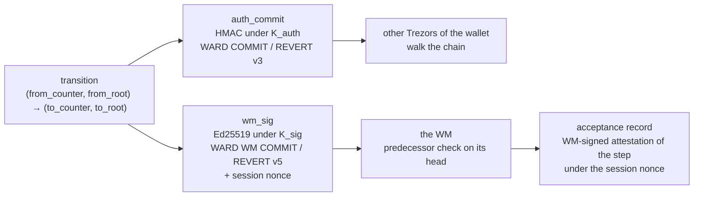
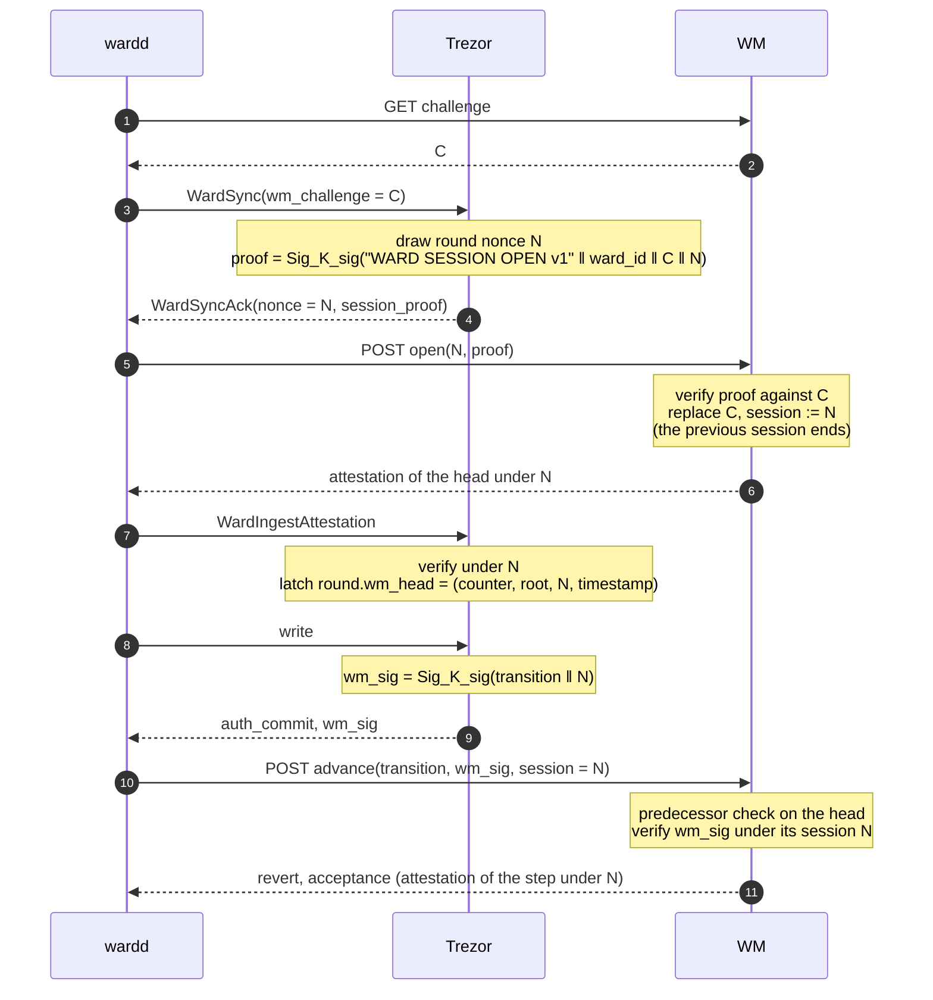
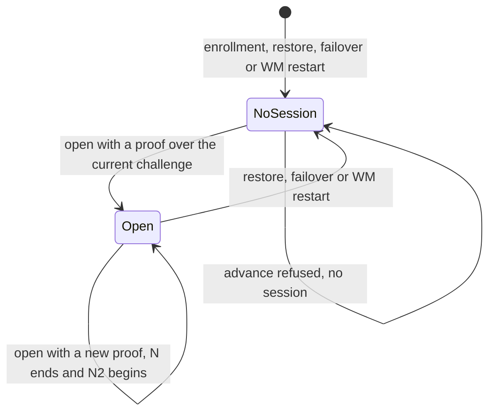
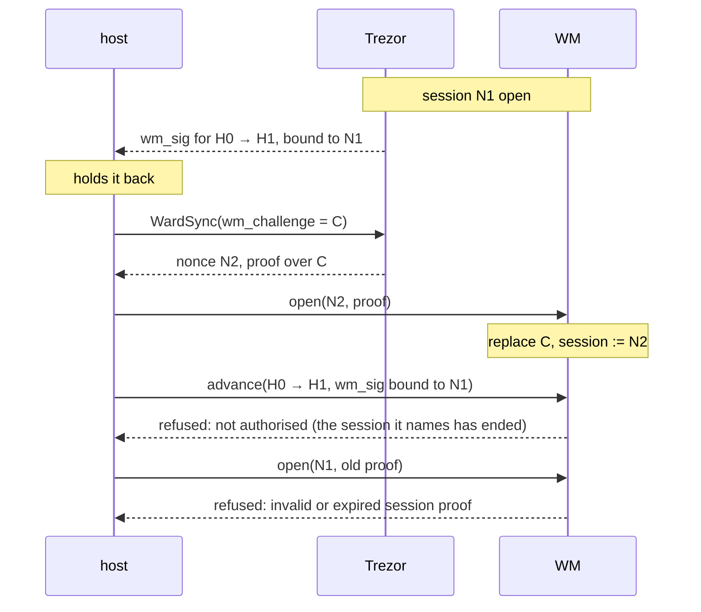

# WARD transitions and sessions

A transition moves a wallet's WARD head from `(from_counter, from_root)` to
`(to_counter, to_root)`. The Trezor authorizes every transition twice: once for other Trezors
of the wallet, and once for the [WARD Manager](ward_manager.md). The WM authorization is bound to
a session that the Trezor opens when it syncs.

## The transition

Both authorizations sign the same bytes:

```
transition_preimage = len8(tag) || tag || ward_id(32)
                      || from_counter(4B BE) || from_root(32)
                      || to_counter(4B BE)   || to_root(32)
```

`ward_id` is the Ed25519 public key of the wallet's `K_sig`. An empty tree is encoded as
`EMPTY_ROOT = sha256(0x02)`. A transition raises the counter by 1 to `MAX_BATCH` (8): one change,
or a batch of queued changes. A revert also raises the counter. It carries an older root under a
new counter. Within one WM register history, a `(counter, root)` pair therefore occurs once.

| Authorization | Key | Tag | Appended | Verified by |
| --- | --- | --- | --- | --- |
| `auth_commit` | HMAC-SHA256 under `K_auth` | `WARD COMMIT v3`, `WARD REVERT v3` | nothing | other Trezors of the wallet, walking the chain |
| `wm_sig` | Ed25519 under `K_sig` | `WARD WM COMMIT v5`, `WARD WM REVERT v5` | the session nonce (32 bytes) | the WM, with `ward_id` |
| `head_init_sig` | Ed25519 under `K_sig` | `WARD WM INIT v4` | nothing | the WM, once, at enrollment |
| MVP host step | Ed25519 under `K_sig` | `WARD STEP v2` | nothing | wardd without a WM |

`head_init_sig` is a self-transition `(0, root) -> (0, root)`. The WM enrolls a wallet only at
genesis. Code: [`apps/ward/transition.py`](../../core/src/apps/ward/transition.py).

The Trezor signs one more statement with `K_sig`, which is not a transition: the
[session proof](#sessions), `"WARD SESSION OPEN v1" || ward_id || wm_challenge || nonce`.



## The WM attestation

The WM answers a sync by signing the step that reached its head, bound to the Trezor's nonce:

```
b"WARD ATTEST v1" || 0x07 || nonce(32) || ward_id(32)
  || from_counter(4B BE) || from_root(32) || to_counter(4B BE) || to_root(32)
  || timestamp(8B BE)
```

The timestamp is the WM's clock when it signs: the WM vouches that this step reached its head by
then. The WM keeps no time in its register. An acceptance record is dated when the WM accepted the
step; a later attestation of the same head is dated later. wardd keeps the signed records, and with
them the times (see [the records](ward_roll_forward.md#the-records)). The Trezor stores the time of the
attestation it adopted, so its offline warning reads "Not reflecting changes since" the moment the
WM last confirmed its head.

The signature uses the WM key. Release firmware carries a placeholder key and refuses every
attestation. Debug and emulator firmware accept the debug key. Code:
[`apps/ward/attest.py`](../../core/src/apps/ward/attest.py).

The same statement serves three purposes, distinguished by where the nonce comes from:

- **Live attestation.** The nonce is the Trezor's open round. The Trezor adopts the head only
  from this. The WM signs one when it opens a session, and on a read-only `attest`.
- **WM acceptance record.** The WM signs the new step under the session nonce when it accepts an
  advance. Roll-forward presents it after a restore.
- **Cached attestation or rollback receipt.** A host keeps a past attestation. It proves that the
  WM once held or accepted that step. `WardCatchUp` and `WardRollback` verify it with the nonce it
  carries and treat it as history, never as currency.

## Sessions

A session binds the Trezor's WM authorizations to its most recent sync. Only the Trezor picks
the nonce; the WM never does. The WM keeps a volatile, single-use 32-byte challenge per wallet,
which anyone may read without effect.

1. **The Trezor signs an opening.** It draws a fresh 32-byte round nonce and signs it, with the
   WM's current challenge, under `K_sig`:
   `session_proof = Sig("WARD SESSION OPEN v1" || ward_id || challenge || nonce)`. wardd passes
   the challenge in `WardSync.wm_challenge`; the service channel fetches it with
   `WardSyncRequest.challenge_only`. Without a challenge there is no proof, and the round can only
   read.
2. **The WM opens the session.** It verifies the proof against its challenge, replaces the
   challenge, makes the nonce the wallet's session nonce, and returns its head's attestation under
   it. The previous session ends. Only a Trezor of the wallet can open a session, and each proof
   opens one once: see [why the opening is authenticated](#why-the-opening-is-authenticated).
3. **The Trezor latches it.** After verifying the attestation, the Trezor stores
   `(counter, root, nonce, timestamp)` in its session cache (`round.wm_head`). It latches the
   nonce even if it then refuses the head.
4. **The Trezor binds each authorization.** Every `wm_sig` it produces signs the transition
   together with the session nonce: `transition_preimage || nonce`. Without a session it signs
   nothing and answers "no WM session; sync first".
5. **The WM checks the binding.** It accepts an advance only if `wm_sig` verifies against the
   session nonce it holds, under the commit or revert tag, and the `from` end is its current head
   (predecessor check). The host may name the session it believes is current; see
   [the optional session field](#the-optional-session-field).
6. **The WM signs its acceptance.** It returns an acceptance record: the attestation of the new
   step under the session nonce. The host keeps it.

A head change does not end the session, so one session can carry several transitions. A
read-only `attest` signs the head under any nonce the host names and leaves the session as it
is. Roll-forward uses it between pages, and the service channel uses it for each publication:
the publication carries a fresh nonce, the WM attests the new step against it, and the Trezor
keeps the session nonce of its sync (`write_session` in `adopt.verify_round_attestation`).

Code: [`apps/ward/sync.py`](../../core/src/apps/ward/sync.py),
[`apps/ward/round.py`](../../core/src/apps/ward/round.py), `transition.session_proof`; the WM side is
`DevWm.openSession` in `packages/ward-core/src/wm.ts` and `MockWM.open_session` in
`tests/ward_wm.py`.



The WM's session state per wallet:



### What a session prevents

An authorization that did not land in its session is dead once the wallet syncs again:

- **A lost race.** Two Trezors mint from the same head and one lands first. The loser's `wm_sig`
  fails the predecessor check, and the next sync ends its session.
- **A publication the host held back.** It is refused after any later sync.
- **A replayed opening.** An opening proof is bound to the challenge it consumed, so an old proof
  cannot reopen its session. The challenge is volatile too: after a restart or a restore, no
  proof signed before verifies.
- **A host ending a session.** Only a Trezor of the wallet can sign an opening. Reading the head
  or the challenge does not disturb the Trezor that is writing.

The session nonce is volatile WM state. A restored backup, a failover, or a lost register drops
it. So a restored WM accepts none of the `wm_sig`s minted before the restore. What the WM had
accepted comes back by [roll-forward](ward_roll_forward.md).



Tests:

- **Firmware device tests** in `tests/device_tests/misc/test_ward.py`:
  - `test_ward_attack_a_write_from_an_ended_session_is_refused`: a held write is refused after the
    same device syncs again.
  - `test_ward_attack_another_devices_sync_ends_this_devices_session`: the same, after another
    device of the wallet syncs.
  - `test_ward_attack_a_revert_from_an_ended_session_is_refused`: a held REVERT is refused after a
    new sync.
  - `test_ward_a_write_is_bound_to_the_latest_sync`: the Trezor binds to its latest attestation.
- **Mock WM tests** in `tests/test_ward_wm.py`:
  `test_only_a_fresh_device_proof_can_replace_the_write_session` replays an old opening proof.
- **wardd tests** in the "ADVERSARIAL: a transition is invalidated by a new sync" group of
  `host.test.ts`, and in `service.test.ts`: the host and the WM each refuse a result whose session
  has ended. `wmServer.test.ts` opens a session only with the proof for the outstanding challenge.

### What a session does not prevent

- **Concurrent Trezors.** A sync by one Trezor of the wallet ends the session of every other.
  Their next publication is refused, and they sync again.
- **Delay.** Within a session, a host may delay a publication while nothing else lands.
- **A withheld opening.** A host can hold an opening proof back and submit it later. It stays
  valid until another opening consumes the challenge. This is the same delay, moved before the
  session opens.

## Why the session is part of the signature

The WM checks three things before it advances:

- **Who:** the signature verifies under `ward_id`.
- **Where:** the `from` end is its head, by a predecessor check.
- **When:** the signature is bound to the current session.

The predecessor check alone makes an authorization single-use within one register history,
because the counter only rises. It does not stop an authorization from landing **late**:

- **Late but valid.** An authorization minted on head H stays valid for as long as H is the head.
  A host can hold it, a lost race can wait, and a restore that brings H back makes it valid again.
- **What the session adds.** Binding the signature to the nonce of the Trezor's sync limits it to
  that sync. The next sync, by any Trezor of the wallet, ends it. A restore ends it too, because
  the session nonce is volatile.

The nonce lives inside the signature. That is the only place the WM can check it: the Trezor never
sends a separate field the WM would have to trust.

### Why the opening is authenticated

The session nonce decides which authorizations the WM accepts, so whoever sets it controls that.
A nonce alone does not tell the WM whether a Trezor just drew it or a host replays an old one.
When any attestation request opened a session, two attacks followed:

- **Reviving held writes.** A host asked for an attestation under an old nonce, which made that
  session current again, and landed the writes it had held back from it.
- **Ending a session.** Anyone able to ask for an attestation ended the session of the Trezor that
  was writing.

Each part of the proof has a job:

- **`K_sig`:** only a Trezor of the wallet can open a session.
- **The challenge:** single-use, so a proof opens one session once, and an old proof cannot
  reopen its session. A restore or restart draws a new one.
- **The nonce:** the session opened is the one the Trezor just drew and will sign under.

See [authenticated write sessions](gaps.md#authenticated-write-sessions).

### Consequence: a stored signature cannot be verified later

The session nonce is not part of the transition the Trezor sends. A result carries `counter`,
`auth_commit` and `wm_sig`, but no nonce. A stored `wm_sig` can therefore be verified only by a
party that knows which session it was minted in:

- **The WM:** only while that session is current.
- **wardd:** only for the sessions it opened itself.

After the session ends, nobody can tell a stored `wm_sig` for an accepted transition from one for
a lost race. So the stored signatures cannot be used to rebuild the WM's history. Rebuilding has
to start from what only the WM produced: its responses, the acceptance records and attestations
that sign each step it accepted.

## Roll-forward

A WM whose register goes back no longer holds transitions it accepted. A Trezor of the wallet
signs the accepted steps again for its current session, checking its own MAC and the WM's record
of each, and wardd submits them as ordinary advances. The alternative, the WM accepting its own
records directly, is not implemented. See [WARD roll-forward](ward_roll_forward.md).

## The optional session field

The advance request may carry `session`: the nonce the host believes the WM holds. It is
**diagnostics only**. The WM always verifies the signature against the nonce it holds and never
trusts the field. When verification fails and the named session differs from the WM's, the
refusal says that the session it names has ended. A host can then sync and ask the Trezor again,
rather than treat the refusal as a forgery. wardd sends the nonce of the latest session it opened
with a Trezor's proof.

## Alternative: transitions without `from`

Two variants remove the `from` end. Neither is used.

### Omitting `from` from the advance request only

The Trezor still signs `from_counter` and `from_root`. The WM substitutes its own head when it
verifies, so a transition built on another head fails verification. The predecessor check becomes
implicit.

- **Security:** unchanged. The signature still commits to the predecessor.
- **Drawbacks:**
  - A stale head and a forged signature produce the same refusal. The WM has to return its head
    counter so the host can tell the two apart.
  - The links, attestations, acceptance records and `WardRollForward` still carry `from`. Only
    the advance request shrinks, by 36 bytes.

### Omitting `from` from the signature

The Trezor would sign only `(to_counter, to_root, session)`. The WM would have to infer where a
transition starts.

- **A batch passes the counter check.** In one session the Trezor can authorize H to A at c+1
  and a batch H to B at c+3; a host can hold the first back. After A lands, "to_counter above the
  head" accepts B. B lacks A's change, so the WM forks and silently loses A after signing its
  acceptance.
- **Two roots at one counter.** After a restore, the WM can hold (c, R_wm) while a Trezor holds
  (c, R_dev). The Trezor latches the attestation's nonce before it refuses the head, so it could
  authorize a write from (c, R_dev). Without `from_root` in the signature, the WM would accept it
  on a tree it does not hold.
- **Closing these.** Signing `from_counter` alone, plus a Trezor rule to mint only from the head
  its latched attestation names, would close both. That saves 32 bytes, adds an invariant every
  minting path must keep, and splits the preimage from `auth_commit`'s, which needs `from` for the
  chain walk.
