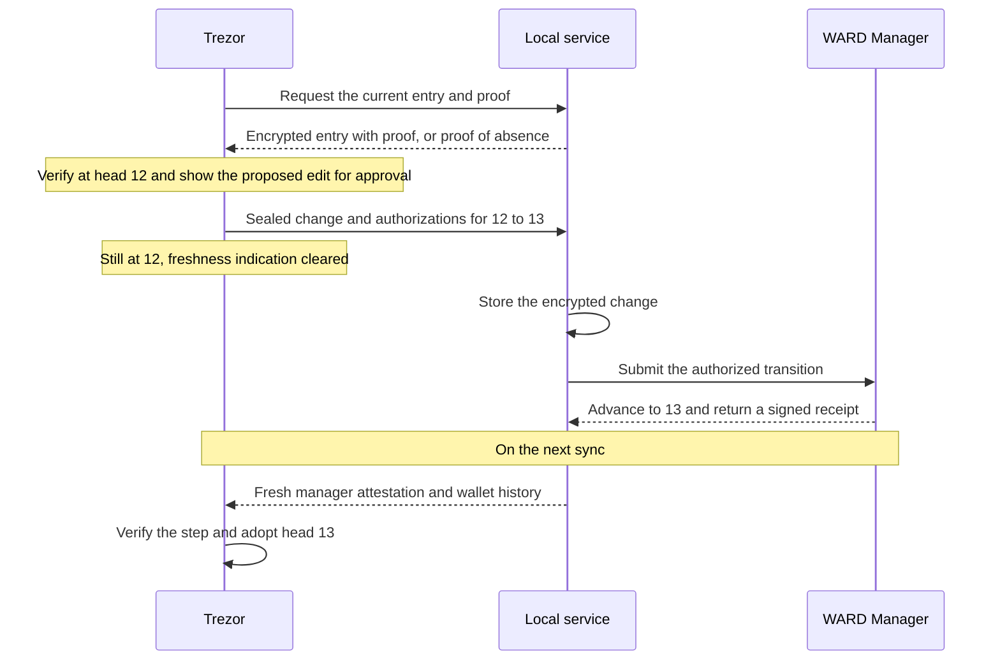

# Transitions and sessions

A transition identifies the wallet and its starting and resulting heads. 
The counter advances by the number of changes. -- This should be verified for batch updates and 

The manager accepts one successor per head, so along its history each counter names one state. A lost race, a manager restored from backup, or the MVP without a manager can still produce different roots at the same counter; the root tells them apart.

## From approval to adoption

Suppose a user changes an address label while the Trezor and manager both hold head 12. The
device can authorize head 13 before either party adopts it.

The wallet authentication tag lets another Trezor verify the step later. The public signature lets
the manager check the current writer and predecessor. If the reply is lost, the device can learn on
sync whether its step landed. In the MVP the service checks the public signature itself, and the
device adopts by verifying the chain back to its stored head.

## Sessions

The Trezor signs the manager's single-use challenge and its own fresh nonce. The manager verifies
the signature, consumes the challenge and replaces the wallet's previous write session. A read-only
attestation leaves the active session in place.

A delayed write can land while both its session and predecessor remain current, even after the
device disconnects. A write displaced by another session or a competing change requires a new sync.

## Competing writers

Suppose a second Trezor opens a session and publishes a change before the first Trezor's label edit
reaches the manager. The first device syncs to the winning head. Its host can then present the
original edit with a wallet-authenticated retry token. The device verifies the token and checks
the entry at the newly adopted root.

| What the device finds | What happens to the edit |
| --- | --- |
| The entry has the same write counter as at approval. | The device can authorize the edit against the new head without asking again. |
| The counter changed and the intended value is already there. | The edit is complete. Nothing is published. |
| The counter changed and the values differ. | The device shows both values. Overwriting the published value requires confirmation. |

Device on a competing branch requires proof of descent from its own head. A higher counter alone is insufficient.
