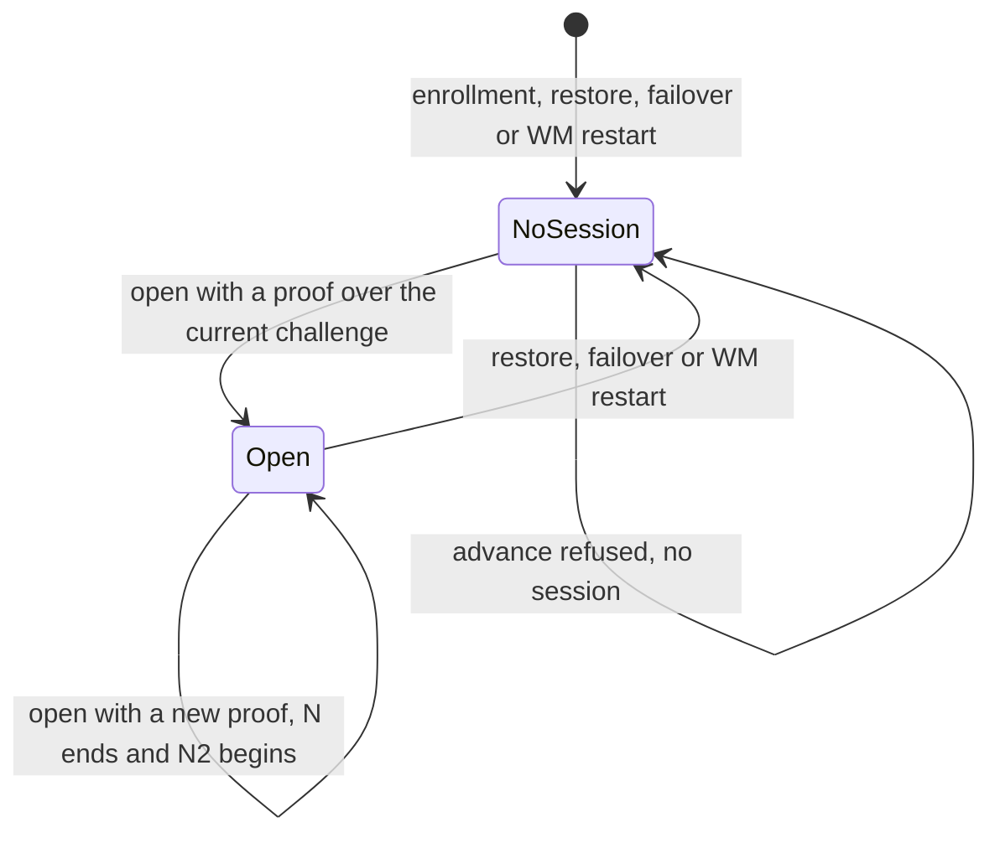
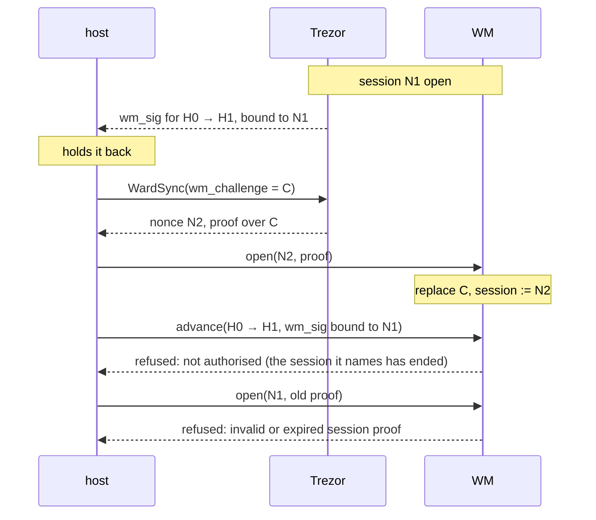
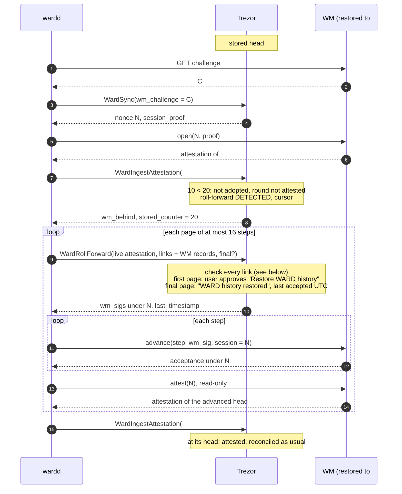
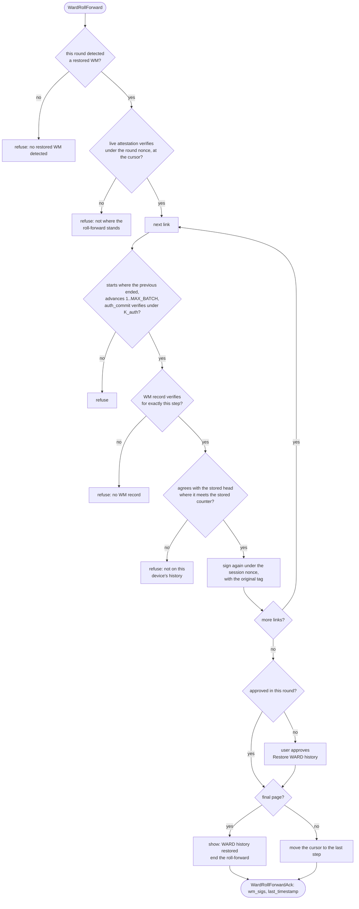
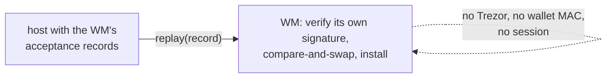

# WARD transitions and sessions

A transition moves a wallet's WARD head from `(from_counter, from_root)` to
`(to_counter, to_root)`. The Trezor authorizes every transition twice: once for other Trezors
of the wallet, and once for the [WARD Manager](ward_manager.md). The WM authorization is bound to
a session that the Trezor opens when it syncs.

## The transition

Both authorizations sign the same bytes:

```
transition_preimage = len8(tag) || tag || ward_id(32)
                      || from_counter(4B BE) || from_root(32)
                      || to_counter(4B BE)   || to_root(32)
```

`ward_id` is the Ed25519 public key of the wallet's `K_sig`. An empty tree is encoded as
`EMPTY_ROOT = sha256(0x02)`. A transition raises the counter by 1 to `MAX_BATCH` (8): one change,
or a batch of queued changes. A revert also raises the counter. It carries an older root under a
new counter. Within one WM register history, a `(counter, root)` pair therefore occurs once.

| Authorization | Key | Tag | Appended | Verified by |
| --- | --- | --- | --- | --- |
| `auth_commit` | HMAC-SHA256 under `K_auth` | `WARD COMMIT v3`, `WARD REVERT v3` | nothing | other Trezors of the wallet, walking the chain |
| `wm_sig` | Ed25519 under `K_sig` | `WARD WM COMMIT v5`, `WARD WM REVERT v5` | the session nonce (32 bytes) | the WM, with `ward_id` |
| `head_init_sig` | Ed25519 under `K_sig` | `WARD WM INIT v4` | nothing | the WM, once, at enrollment |
| MVP host step | Ed25519 under `K_sig` | `WARD STEP v2` | nothing | wardd without a WM |

`head_init_sig` is a self-transition `(0, root) -> (0, root)`. The WM enrolls a wallet only at
genesis. Code: [`apps/ward/cas.py`](../../core/src/apps/ward/cas.py).

The Trezor signs one more statement with `K_sig`, which is not a transition: the
[session proof](#sessions), `"WARD SESSION OPEN v1" || ward_id || wm_challenge || nonce`.


## The WM attestation

The WM answers a sync by signing the step that reached its head, bound to the Trezor's nonce:

```
b"WARD ATTEST v1" || 0x07 || nonce(32) || ward_id(32)
  || from_counter(4B BE) || from_root(32) || to_counter(4B BE) || to_root(32)
  || timestamp(8B BE)
```

The signature uses the WM key. Release firmware carries a placeholder key and refuses every
attestation. Debug and emulator firmware accept the debug key. Code:
[`apps/ward/attest.py`](../../core/src/apps/ward/attest.py).

The same statement serves three purposes, distinguished by where the nonce comes from:

- **Live attestation.** The nonce is the Trezor's open round. The Trezor adopts the head only
  from this. The WM signs one when it opens a session, and on a read-only `attest`.
- **WM acceptance record.** The WM signs the new step under the session nonce when it accepts an
  advance. Roll-forward presents it after a restore.
- **Cached attestation or rollback receipt.** A host keeps a past attestation. It proves that the
  WM once held or accepted that step. `WardCatchUp` and `WardRollback` verify it with the nonce it
  carries and treat it as history, never as currency.

## Sessions

A session binds the Trezor's WM authorizations to its most recent sync. Only the Trezor picks
the nonce. The WM never does. Only a Trezor of the wallet can open a session, and each opening
is single-use.

1. **The WM supplies a challenge.** It keeps one volatile 32-byte challenge per wallet and hands
   it to anyone who asks. Reading it changes nothing. wardd passes it to the Trezor in
   `WardSync.wm_challenge`. On the service channel the Trezor asks for it first, with
   `WardSyncRequest.challenge_only`.
2. **The Trezor proves the opening.** It draws a fresh 32-byte round nonce and signs
   `"WARD SESSION OPEN v1" || ward_id || wm_challenge || nonce` under `K_sig`. It returns both in
   `WardSyncAck.nonce` and `WardSyncAck.session_proof`, or sends them in `WardSyncRequest` on the
   service channel. Without a challenge it returns no proof, and the round can only read.
3. **The WM opens the session.** In one step, it verifies the proof under `ward_id` against its
   current challenge, replaces the challenge, and installs the nonce as the wallet's session
   nonce. It returns the attestation of its head under that nonce. The previous session, of any
   Trezor of the wallet, ends here.
4. **The Trezor latches it.** After verifying the attestation, the Trezor stores
   `(counter, root, nonce, timestamp)` in its session cache (`round.wm_head`). It latches the
   nonce even if it then refuses the head.
5. **The Trezor binds each authorization.** It mints every `wm_sig` over
   `transition_preimage || nonce` and refuses to mint one without a session: "no WM session; sync
   first".
6. **The WM checks the binding.** It accepts an advance only if `wm_sig` verifies against the
   session nonce it holds, under the commit or revert tag, and the `from` end is its current head
   (compare-and-swap). The host may name the session it believes is current; see
   [the optional session field](#the-optional-session-field).
7. **The WM signs its acceptance.** It returns an acceptance record: the attestation of the new
   step under the session nonce. The host keeps it.

A head change does not end the session, so one session can carry several transitions. A
read-only `attest` signs the head under any nonce the host names and leaves the session as it
is. Roll-forward uses it between pages, and the service channel uses it for each publication:
the publication carries a fresh nonce, the WM attests the new step against it, and the Trezor
keeps the session nonce of its sync (`write_session` in `adopt.verify_round_attestation`).

Code: [`apps/ward/sync.py`](../../core/src/apps/ward/sync.py),
[`apps/ward/round.py`](../../core/src/apps/ward/round.py), `cas.session_proof`; the WM side is
`DevWm.openSession` in `packages/ward-core/src/wm.ts` and `MockWM.open_session` in
`tests/ward_wm.py`.


The WM's session state per wallet:



### What a session prevents

An authorization that did not land in its session is dead once the wallet syncs again:

- **A lost race.** Two Trezors mint from the same head and one lands first. The loser's `wm_sig`
  fails the compare-and-swap, and the next sync ends its session.
- **A publication the host held back.** It is refused after any later sync.
- **A replayed opening.** An opening proof is bound to the challenge it consumed, so an old proof
  cannot reopen its session. The challenge is volatile too: after a restart or a restore, no
  proof signed before verifies.
- **A host ending a session.** Only a Trezor of the wallet can sign an opening. Reading the head
  or the challenge does not disturb the Trezor that is writing.

The session nonce is volatile WM state. A restored backup, a failover, or a lost register drops
it. So a restored WM accepts none of the `wm_sig`s minted before the restore. What the WM had
accepted comes back by [roll-forward](#roll-forward).



Tests:

- **Firmware device tests** in `tests/device_tests/misc/test_ward.py`:
  - `test_ward_attack_a_write_from_an_ended_session_is_refused`: a held write is refused after the
    same device syncs again.
  - `test_ward_attack_another_devices_sync_ends_this_devices_session`: the same, after another
    device of the wallet syncs.
  - `test_ward_attack_a_revert_from_an_ended_session_is_refused`: a held REVERT is refused after a
    new sync.
  - `test_ward_a_write_is_bound_to_the_latest_sync`: the Trezor binds to its latest attestation.
- **Mock WM tests** in `tests/test_ward_wm.py`:
  `test_only_a_fresh_device_proof_can_replace_the_write_session` replays an old opening proof.
- **wardd tests** in the "ADVERSARIAL: a transition is invalidated by a new sync" group of
  `host.test.ts`, and in `service.test.ts`: the host and the WM each refuse a result whose session
  has ended. `wmServer.test.ts` opens a session only with the proof for the outstanding challenge.

### What a session does not prevent

- **Concurrent Trezors.** A sync by one Trezor of the wallet ends the session of every other.
  Their next publication is refused, and they sync again.
- **Delay.** Within a session, a host may delay a publication while nothing else lands.
- **A withheld opening.** A host can hold an opening proof back and submit it later. It stays
  valid until another opening consumes the challenge. This is the same delay, moved before the
  session opens.

## Why the session is part of the signature

The WM checks three things before it advances:

- **Who:** the signature verifies under `ward_id`.
- **Where:** the `from` end is its head, by compare-and-swap.
- **When:** the signature is bound to the current session.

The compare-and-swap alone makes an authorization single-use within one register history,
because the counter only rises. It does not stop an authorization from landing **late**:

- **Late but valid.** An authorization minted on head H stays valid for as long as H is the head.
  A host can hold it, a lost race can wait, and a restore that brings H back makes it valid again.
- **What the session adds.** Binding the signature to the nonce of the Trezor's sync limits it to
  that sync. The next sync, by any Trezor of the wallet, ends it. A restore ends it too, because
  the session nonce is volatile.

The nonce lives inside the signature. That is the only place the WM can check it: the Trezor never
sends a separate field the WM would have to trust.

### Why the opening is authenticated

A nonce alone does not tell the WM whether a Trezor just drew it or a host replays an old one.
When any attestation request opened a session, a host could ask for an attestation under an old
nonce and then land that session's held writes, and anyone able to ask could end the session of
the Trezor that was writing. The opening proof closes both: it is signed under `K_sig`, so only a
Trezor of the wallet can open a session, and it covers the WM's single-use challenge, so each
proof opens one session once. See
[authenticated write sessions](gaps.md#authenticated-write-sessions).

### Consequence: a stored signature cannot be verified later

The session nonce is not part of the transition the Trezor sends. A result carries `counter`,
`auth_commit` and `wm_sig`, but no nonce. A stored `wm_sig` can therefore be verified only by a
party that knows which session it was minted in:

- **The WM:** only while that session is current.
- **wardd:** only for the sessions it opened itself.

After the session ends, nobody can tell a stored `wm_sig` for an accepted transition from one for
a lost race. So the stored signatures cannot be used to rebuild the WM's history. Rebuilding has
to start from what only the WM produced: its responses, the acceptance records and attestations
that sign each step it accepted.

## Roll-forward

A WM whose register goes back no longer holds transitions it accepted. That happens after a
restored backup, a failover onto a stale replica, or a lost register. A host that kept the WM's
records of those transitions can bring the WM back. There are two ways to do it.

### Option A: the Trezor signs the transitions again (implemented)

It runs in four stages:

1. **The Trezor detects the restored WM during a sync.** When `WardIngestAttestation` attests a
   head below the Trezor's stored head, the Trezor does not adopt it and does not fail. It
   answers `wm_behind`, with its stored counter, and records the detection for this round. The
   round stays open but is not attested, so nothing can be adopted from it.
2. **The host feeds the accepted transitions.** Oldest first, in `WardRollForward`, at most 16
   per message. The Trezor refuses `WardRollForward` in a round without that detection.
3. **The user approves.** On the first page, after checking it, the Trezor shows "Restore WARD
   history": the WM's change number, its own, and how many changes that page signs again.
   Later pages of the same round need no new approval.
4. **The Trezor tells the result.** On the last page (`final`), it shows "WARD history
   restored": the change number the pages reached and when the WM accepted the last of those
   changes, in UTC. It also returns that time as `last_timestamp`. The user can see how recent
   the restored history is.

Each `WardRollForward` message carries:

- the WM's live attestation of its current head, against the round nonce of the session the
  Trezor opened in this sync;
- each transition with its `auth_commit` and the WM's acceptance record of exactly that step
  (`WardChainLink.acceptance`).

The Trezor considers a transition valid only if **both** of its checks pass:

1. **Its own MAC.** The `auth_commit` verifies under `K_auth`, so a Trezor of this wallet made the
   step. A WM cannot sign itself a history.
2. **The WM's signature.** The acceptance record verifies under the WM key over exactly this step,
   so the WM accepted it. A lost race or a publication held back has no record.

It also checks two things about the chain:

- **Contiguity.** The first step of the round starts at the attested head, and each step starts
  where the previous one ended. A later page starts where the previous page ended
  ("not where the roll-forward stands" otherwise).
- **Its own history.** No step jumps over the Trezor's stored counter, and a step that starts or
  ends at the stored counter has the stored root there. The Trezor re-authorizes history it is
  on, and steps beyond its head that continue from it; never a branch it would refuse.

It then signs each step again under the session nonce, with the step's original tag: a revert
stays a revert. It returns the signatures in `WardRollForwardAck`, and the host submits them to
the WM as ordinary advances. Before the next page, the host has the WM attest its advanced head
against the same round nonce. That attestation is read-only and leaves the session open. When
roll-forward ends, the host ingests a fresh attestation and the Trezor reconciles as usual.

The user confirmed each change when it was made, and the WM accepted it. The approval is for the
restore itself: re-binding history the WM had lost to the current session. Code:
[`apps/ward/roll_forward.py`](../../core/src/apps/ward/roll_forward.py), wardd
`WardHost.rollForward`. See [roll-forward in the WM](ward_manager.md#roll-forward).



What the Trezor checks on each `WardRollForward` page:



- **For:**
  - The WM keeps one way in: a Trezor-signed advance in the current session.
  - The Trezor checks every step itself, and a hostile WM cannot sign a history the wallet never
    made.
  - The re-signed steps are bound to a session like any other authorization, so they expire with it.
- **Against:**
  - A Trezor must be connected, ahead of the restored WM, and the user must approve.
  - Each step costs a MAC check, a WM signature check and a new signature on the device.
  - The deprecated service channel does not support it.

Open findings about this flow are in [gaps.md](gaps.md):
[freshness after detected regression](gaps.md#freshness-after-detected-regression),
[roll-forward consent and completion](gaps.md#roll-forward-consent-and-completion) (the approval
counts only the first page, and the final screen shows before wardd submits the signatures),
[recovery dates](gaps.md#recovery-dates), and
[recovery through relay clients](gaps.md#recovery-through-relay-clients).

### Option B: the WM accepts its own records directly (not implemented)

The host presents the WM's acceptance records to the WM. The WM verifies its own signature over
each step, compare-and-swaps on its head, and installs the step. No Trezor is involved.



- **For:**
  - It works while no Trezor is connected.
  - It is cheap: one signature check per step, on the WM.
- **Against:**
  - The WM gains a second way in that bypasses the Trezor. A WM bug or key compromise there is
    not checked by any wallet MAC.
  - Anyone holding the records can drive the WM forward with no device present, which widens the
    prefix choice below.
  - The records are not bound to any session, so they never expire.

### What both options leave open

Whoever holds the records chooses how far the WM is replayed, and after two restores also which
branch. The WM then attests an old genuine head as current. This is an accepted gap. See
[WM restore and roll-forward](gaps.md#wm-restore-and-roll-forward).

## The optional session field

The advance request may carry `session`: the nonce the host believes the WM holds. It is
**diagnostics only**. The WM always verifies the signature against the nonce it holds and never
trusts the field. When verification fails and the named session differs from the WM's, the
refusal says that the session it names has ended. A host can then sync and ask the Trezor again,
rather than treat the refusal as a forgery. wardd sends the nonce of the latest session it opened
with a Trezor's proof.

## Alternative: transitions without `from`

Two variants remove the `from` end. Neither is used.

### Omitting `from` from the advance request only

The Trezor still signs `from_counter` and `from_root`. The WM substitutes its own head when it
verifies, so a transition built on another head fails verification. The compare-and-swap becomes
implicit.

- **Security:** unchanged. The signature still commits to the predecessor.
- **Drawbacks:**
  - A stale head and a forged signature produce the same refusal. The WM has to return its head
    counter so the host can tell the two apart.
  - The links, attestations, acceptance records and `WardRollForward` still carry `from`. Only
    the advance request shrinks, by 36 bytes.

### Omitting `from` from the signature

The Trezor would sign only `(to_counter, to_root, session)`. The WM would have to infer where a
transition starts.

- **A batch passes the counter check.** In one session the Trezor can authorize H to A at c+1
  and a batch H to B at c+3; a host can hold the first back. After A lands, "to_counter above the
  head" accepts B. B lacks A's change, so the WM forks and silently loses A after signing its
  acceptance.
- **Two roots at one counter.** After a restore, the WM can hold (c, R_wm) while a Trezor holds
  (c, R_dev). The Trezor latches the attestation's nonce before it refuses the head, so it could
  authorize a write from (c, R_dev). Without `from_root` in the signature, the WM would accept it
  on a tree it does not hold.
- **Closing these.** Signing `from_counter` alone, plus a Trezor rule to mint only from the head
  its latched attestation names, would close both. That saves 32 bytes, adds an invariant every
  minting path must keep, and splits the preimage from `auth_commit`'s, which needs `from` for the
  chain walk.
